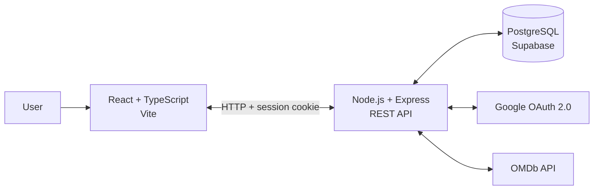

<div align="center">


# My Movie Diary

**A personal space to track, rate, and remember every movie you watch.**

[](https://deepwiki.com/rhythm162k/my_movie_diary)


[Live Demo](https://my-movie-diary.onrender.com) · [Repository](https://github.com/rhythm162k/my_movie_diary)

</div>

---

## Overview

**My Movie Diary** is a full-stack web application for keeping a personal record of the movies you watch. Users can create an account, add movies to their collection, rate them, write personal notes, and revisit their movie history whenever they want.

When a movie is added, the backend looks up its poster through the **OMDb API**, making it easier to build a visual movie collection without manually searching for artwork.

The application uses a React and TypeScript frontend, an Express and TypeScript backend, and PostgreSQL for persistent data storage. It is deployed on Render, with Supabase hosting the production PostgreSQL database.

## Features

- **Personal movie library** — each account has its own private movie collection.
- **Movie ratings and notes** — record a rating and write down your thoughts about each movie.
- **Automatic poster lookup** — fetches movie posters using the OMDb API, with a fallback when a poster is unavailable.
- **Search and pagination** — find movies in your collection and browse the list in manageable pages.
- **Movie management** — add, edit, and delete movie entries.
- **Authentication** — register and sign in with email and password or Google OAuth.
- **Duplicate prevention** — prevents the same user from adding a movie title more than once.
- **Responsive interface** — adapts the movie collection and forms to different screen sizes.

## Tech Stack

| Layer                 | Technologies                                             |
| --------------------- | -------------------------------------------------------- |
| Frontend              | React 19, TypeScript, Vite, React Router, Axios          |
| Backend               | Node.js, Express 5, TypeScript                           |
| Database              | PostgreSQL, `pg`                                         |
| Authentication        | Passport.js, Google OAuth 2.0, `express-session`, bcrypt |
| Validation & security | express-validator, express-rate-limit, CORS              |
| External API          | OMDb API                                                 |
| Testing               | Vitest, Supertest                                        |
| Deployment            | Render, Supabase                                         |

## Architecture

The application follows a client-server architecture. The React client communicates with the Express API over HTTP. The backend handles authentication, validates requests, retrieves movie metadata when needed, and performs user-scoped database operations.



## Security & Data Integrity

- **Session-based authentication:** sessions are stored in PostgreSQL and identified by an HTTP-only cookie.
- **Password protection:** passwords are hashed with bcrypt rather than stored as plain text.
- **User-scoped data access:** movie queries are restricted to the authenticated user's ID.
- **Request validation:** incoming data is validated before database operations.
- **Rate limiting:** limits repeated requests, with stricter limits on authentication routes.
- **Parameterized SQL queries:** user-provided values are passed as query parameters to help prevent SQL injection.
- **Duplicate constraints:** a database-level unique index prevents duplicate movie titles within a user's collection.

## Project Structure

```text
myMovieDiary/
├── index.ts
├── middleware/
│   └── rateLimiters.ts
├── tests/
│   ├── auth.test.ts
│   ├── movies.crud.test.ts
│   ├── movies.authz.test.ts
│   └── errors.test.ts
├── frontend/
│   ├── public/
│   └── src/
│       ├── components/
│       ├── context/
│       ├── Pages/
│       ├── App.tsx
│       ├── api.ts
│       └── types.ts
├── 001_schema.sql
├── .env.example
├── package.json
└── SETUP.md
```

## Getting Started

### Prerequisites

- Node.js 20 or newer
- npm
- PostgreSQL database
- OMDb API key (for automatic poster lookup)
- Google OAuth credentials (if you want to enable Google sign-in locally)

### 1. Clone the repository

```bash
git clone https://github.com/rhythm162k/my_movie_diary.git
cd my_movie_diary
```

### 2. Install backend dependencies

```bash
npm install
```

### 3. Install frontend dependencies

```bash
cd frontend
npm install
cd ..
```

### 4. Configure environment variables

Create a `.env` file in the project root using `.env.example` as a reference.

Backend variables:

```env
PG_HOST=localhost
PG_USER=your_database_user
PG_PASSWORD=your_database_password
PG_DATABASE=your_database_name
PG_PORT=5432

PORT=4000
FRONTEND_URL=http://localhost:5173
SESSION_SECRET=replace_with_a_long_random_secret

OMDB_API_KEY=your_omdb_api_key

GOOGLE_CLIENT_ID=your_google_client_id
GOOGLE_CLIENT_SECRET=your_google_client_secret
GOOGLE_CALLBACK_URL=http://localhost:4000/auth/google/callback
```

Create `frontend/.env` and configure the backend URL:

```env
VITE_API_URL=http://localhost:4000
```

Use your own credentials and keep `.env` files out of version control. The repository includes `.env.example` files to show the required configuration.

### 5. Set up the database

Create a PostgreSQL database and apply the schema from:

```text
001_schema.sql
```

The application also uses PostgreSQL to persist Express sessions.

### 6. Run the application

Start the backend from the project root:

```bash
npm run dev
```

In a second terminal, start the frontend:

```bash
cd frontend
npm run dev
```

The local development servers use:

- Frontend: `http://localhost:5173`
- Backend: `http://localhost:4000`

For additional setup details, see [`SETUP.md`](SETUP.md).

## Testing

The backend test suite uses **Vitest** and **Supertest** with a dedicated test database.

```bash
npm test
```

Additional backend scripts:

```bash
npm run test:watch
npm run coverage
npm run typecheck
npm run build
```

The tests cover authentication, movie CRUD operations, authorization boundaries between users, and error handling. Configure a separate `.env.test` database before running the test suite; the project checks that the test database name contains `test`.

For frontend checks:

```bash
cd frontend
npm run lint
npm run build
```

## Deployment

The application is deployed on **Render**:

- **Backend:** Render Web Service
- **Frontend:** Render Static Site
- **Production database:** Supabase PostgreSQL

The frontend is configured with `VITE_API_URL` pointing to the deployed backend. The backend uses production environment variables for its database connection, session secret, frontend origin, OMDb API key, and Google OAuth credentials.

<sub>On Render's free tier, an idle backend service may sleep and take a little time to respond to its first request. The app displays a server-waking screen while the initial session check is pending.</sub>

---

<div align="center">

**Built by [Rhythm](https://github.com/rhythm162k)**

_A personal project built to practice full-stack application development._

</div>
