# 1-Overview

# Overview

Relevant source files

- [frontend/src/App.jsx](https://github.com/rhythm162k/my_movie_diary/blob/15be8b17/frontend/src/App.jsx)
- [index.js](https://github.com/rhythm162k/my_movie_diary/blob/15be8b17/index.js)
- [package-lock.json](https://github.com/rhythm162k/my_movie_diary/blob/15be8b17/package-lock.json)
- [package.json](https://github.com/rhythm162k/my_movie_diary/blob/15be8b17/package.json)

My Movie Diary is a full-stack web application designed to help users manage and track their watched movies. The platform features a responsive React single-page application bundled with Vite on the client side, supported by a Node.js Express backend and a PostgreSQL database on the server side [index.js1-25](https://github.com/rhythm162k/my_movie_diary/blob/15be8b17/index.js#L1-L25)[frontend/src/App.jsx1-57](https://github.com/rhythm162k/my_movie_diary/blob/15be8b17/frontend/src/App.jsx#L1-L57) It provides secure session-based authentication utilizing both local credential hashing via `bcrypt` and third-party authentication via Google OAuth 2.0 [index.js6-10](https://github.com/rhythm162k/my_movie_diary/blob/15be8b17/index.js#L6-L10)[index.js69-118](https://github.com/rhythm162k/my_movie_diary/blob/15be8b17/index.js#L69-L118)

The following diagram illustrates the high-level system architecture, mapping major logical components to their concrete code entities within the repository:

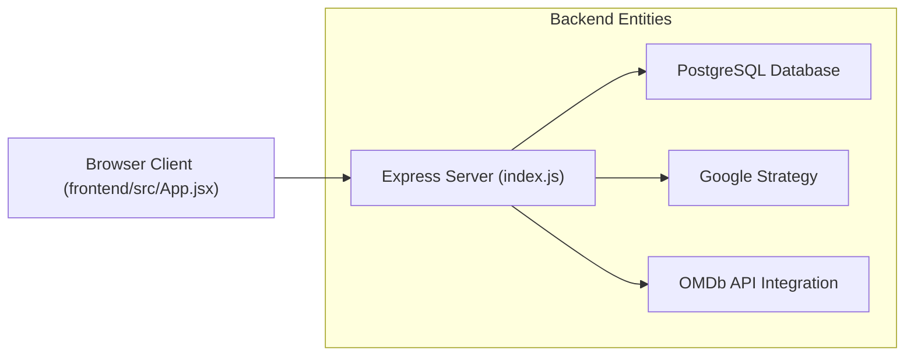

_Sources: [index.js1-118](https://github.com/rhythm162k/my_movie_diary/blob/15be8b17/index.js#L1-L118)[frontend/src/App.jsx1-57](https://github.com/rhythm162k/my_movie_diary/blob/15be8b17/frontend/src/App.jsx#L1-L57)_

---

## 1.1. Getting Started & Configuration

The application relies on several environment variables for database connectivity, API integrations, and OAuth authentication, defined via `dotenv`[index.js3-12](https://github.com/rhythm162k/my_movie_diary/blob/15be8b17/index.js#L3-L12) The backend is initialized using standard npm scripts [package.json6-8](https://github.com/rhythm162k/my_movie_diary/blob/15be8b17/package.json#L6-L8) while database persistence is structured around `pg`[index.js19-25](https://github.com/rhythm162k/my_movie_diary/blob/15be8b17/index.js#L19-L25) and session storage via `connect-pg-simple`[index.js8](https://github.com/rhythm162k/my_movie_diary/blob/15be8b17/index.js#L8-L8)[index.js42-64](https://github.com/rhythm162k/my_movie_diary/blob/15be8b17/index.js#L42-L64)

For detailed installation guides, environment variable configurations (`PG_*`, `OMDb API Key`, `Google OAuth`, `API_URL`), Vite settings, and development scripts, see [Getting Started & Configuration](/rhythm162k/my_movie_diary/1.1-getting-started-and-configuration).

_Sources: [index.js3-25](https://github.com/rhythm162k/my_movie_diary/blob/15be8b17/index.js#L3-L25)[index.js42-64](https://github.com/rhythm162k/my_movie_diary/blob/15be8b17/index.js#L42-L64) [package.json:6-8]_

---

## 1.2. End-to-End Request Flow

Client-side navigation and data fetching operate asynchronously through Axios and React Router [frontend/src/App.jsx1-57](https://github.com/rhythm162k/my_movie_diary/blob/15be8b17/frontend/src/App.jsx#L1-L57) When a user interacts with the application—such as viewing movie lists or submitting new entries—requests are transmitted with credentials enabled to maintain session affinity through Express session cookies (`connect.sid`) [index.js44-65](https://github.com/rhythm162k/my_movie_diary/blob/15be8b17/index.js#L44-L65)[index.js120-230](https://github.com/rhythm162k/my_movie_diary/blob/15be8b17/index.js#L120-L230)

For a complete breakdown of how browser actions traverse Axios interceptors, route guards, Express middleware, and PostgreSQL queries, see [End-to-End Request Flow](/rhythm162k/my_movie_diary/1.2-end-to-end-request-flow).

_Sources: [index.js44-65](https://github.com/rhythm162k/my_movie_diary/blob/15be8b17/index.js#L44-L65)[index.js120-230](https://github.com/rhythm162k/my_movie_diary/blob/15be8b17/index.js#L120-L230)[frontend/src/App.jsx1-57](https://github.com/rhythm162k/my_movie_diary/blob/15be8b17/frontend/src/App.jsx#L1-L57)_

---

# 1.1-Getting-Started-&-Configuration

# Getting Started & Configuration

Relevant source files

- [.gitignore](https://github.com/rhythm162k/my_movie_diary/blob/15be8b17/.gitignore)
- [frontend/.gitignore](https://github.com/rhythm162k/my_movie_diary/blob/15be8b17/frontend/.gitignore)
- [frontend/README.md](https://github.com/rhythm162k/my_movie_diary/blob/15be8b17/frontend/README.md?plain=1)
- [frontend/eslint.config.js](https://github.com/rhythm162k/my_movie_diary/blob/15be8b17/frontend/eslint.config.js)
- [frontend/package-lock.json](https://github.com/rhythm162k/my_movie_diary/blob/15be8b17/frontend/package-lock.json)
- [frontend/package.json](https://github.com/rhythm162k/my_movie_diary/blob/15be8b17/frontend/package.json)
- [frontend/src/App.css](https://github.com/rhythm162k/my_movie_diary/blob/15be8b17/frontend/src/App.css)
- [frontend/vite.config.js](https://github.com/rhythm162k/my_movie_diary/blob/15be8b17/frontend/vite.config.js)
- [package-lock.json](https://github.com/rhythm162k/my_movie_diary/blob/15be8b17/package-lock.json)
- [package.json](https://github.com/rhythm162k/my_movie_diary/blob/15be8b17/package.json)

## Purpose & Scope

This page covers the foundational setup, installation procedures, environment configuration, build tooling, and exclusion conventions for My Movie Diary. It addresses both the Node.js/Express backend service and the React/Vite frontend application, detailing script execution paths, environment variables (`PG_*`, OMDb, Google OAuth, `API_URL`), Vite and ESLint configurations, and `.gitignore` rules.

---

## 1. Installation & Execution Instructions

The project is structured as a monorepo-adjacent layout with separate package manifests for the backend root and the frontend client [package.json1-26](https://github.com/rhythm162k/my_movie_diary/blob/15be8b17/package.json#L1-L26)[frontend/package.json1-33](https://github.com/rhythm162k/my_movie_diary/blob/15be8b17/frontend/package.json#L1-L33)

### Backend Initialization

To install dependencies and start the Express server from the root directory:

```
npm install
npm start
```

The root `package.json` defines the `start` script, which executes the backend entry point via Node.js [package.json6-8](https://github.com/rhythm162k/my_movie_diary/blob/15be8b17/package.json#L6-L8):

- `npm start`: Runs `node index.js` using the native ES module runtime (`"type": "module"`).

### Frontend Initialization

To set up and run the client-side React application:

```
cd frontend
npm install
npm run dev
```

The frontend `package.json` defines standard Vite scripts for development, production builds, and linting [frontend/package.json6-11](https://github.com/rhythm162k/my_movie_diary/blob/15be8b17/frontend/package.json#L6-L11):

- `npm run dev`: Launches the Vite development server with Hot Module Replacement (HMR).
- `npm run build`: Bundles the React application into the `dist/` directory.
- `npm run lint`: Executes static analysis via ESLint across all JavaScript and JSX source files.
- `npm run preview`: Locally preview the production build.

```

```

**Sources:**[package.json1-26](https://github.com/rhythm162k/my_movie_diary/blob/15be8b17/package.json#L1-L26)[frontend/package.json1-33](https://github.com/rhythm162k/my_movie_diary/blob/15be8b17/frontend/package.json#L1-L33)

---

## 2. Environment Variables Configuration

The application relies on environment variables loaded via `dotenv`[package.json18](https://github.com/rhythm162k/my_movie_diary/blob/15be8b17/package.json#L18-L18) on the backend and Vite's built-in env handling on the frontend. Environment files must be placed at the root level and inside the `frontend/` directory where applicable.

### Required Environment Variables

- **PostgreSQL Database (`PG_HOST`, `PG_USER`, `PG_PASSWORD`, `PG_DATABASE`, `PG_PORT`)**: Configures the connection parameters for the `pg` client and `connect-pg-simple` session store.
- **OMDb API Key (`OMDB_API_KEY`)**: Authenticates requests sent to the OMDb API for movie metadata and poster resolution.
- **Google OAuth (`GOOGLE_CLIENT_ID`, `GOOGLE_CLIENT_SECRET`, `GOOGLE_CALLBACK_URL`)**: Credentials utilized by `passport-google-oauth20` to manage third-party authentication flows.
- **API URL (`API_URL`)**: Defines the base HTTP endpoint for Axios requests originating from the React frontend.

```

```

**Sources:**[package.json13-25](https://github.com/rhythm162k/my_movie_diary/blob/15be8b17/package.json#L13-L25)

---

## 3. Build & Toolchain Configuration

### Vite Configuration

The frontend uses Vite with the official React SWC/Babel plugin to optimize build performance and HMR [frontend/vite.config.js1-7](https://github.com/rhythm162k/my_movie_diary/blob/15be8b17/frontend/vite.config.js#L1-L7)

- Configuration is exported via `defineConfig`[frontend/vite.config.js5-7](https://github.com/rhythm162k/my_movie_diary/blob/15be8b17/frontend/vite.config.js#L5-L7)
- Integrates `react()` from `@vitejs/plugin-react` to support JSX compilation and Fast Refresh [frontend/vite.config.js2-6](https://github.com/rhythm162k/my_movie_diary/blob/15be8b17/frontend/vite.config.js#L2-L6)

### ESLint Configuration

Static analysis is configured using ESLint's flat configuration format [frontend/eslint.config.js1-21](https://github.com/rhythm162k/my_movie_diary/blob/15be8b17/frontend/eslint.config.js#L1-L21)

- Ignores the production output directory `dist`[frontend/eslint.config.js8](https://github.com/rhythm162k/my_movie_diary/blob/15be8b17/frontend/eslint.config.js#L8-L8)
- Extends recommended configurations from `@eslint/js`, `eslint-plugin-react-hooks`, and `eslint-plugin-react-refresh`[frontend/eslint.config.js11-15](https://github.com/rhythm162k/my_movie_diary/blob/15be8b17/frontend/eslint.config.js#L11-L15)
- Targets browser global variables and enables JSX parser options [frontend/eslint.config.js16-19](https://github.com/rhythm162k/my_movie_diary/blob/15be8b17/frontend/eslint.config.js#L16-L19)

**Sources:**[frontend/vite.config.js1-7](https://github.com/rhythm162k/my_movie_diary/blob/15be8b17/frontend/vite.config.js#L1-L7)[frontend/eslint.config.js1-21](https://github.com/rhythm162k/my_movie_diary/blob/15be8b17/frontend/eslint.config.js#L1-L21)

---

## 4. Gitignore Conventions

To prevent sensitive configuration data, local build artifacts, and dependency directories from being tracked in version control, both the root and frontend directories enforce explicit exclusion rules.

- **Root `.gitignore`**: Excludes local dependency trees (`node_modules`) and all environment files (`.env`, `.env.*`) [.gitignore1-4](https://github.com/rhythm162k/my_movie_diary/blob/15be8b17/.gitignore#L1-L4)
- **Frontend `.gitignore`**: Excludes build outputs (`dist`, `dist-ssr`), local environment overrides (`*.local`), log files, OS metadata (`.DS_Store`), and IDE configurations (`.vscode/*`, `.idea`) [frontend/.gitignore1-28](https://github.com/rhythm162k/my_movie_diary/blob/15be8b17/frontend/.gitignore#L1-L28)

**Sources:**[.gitignore1-4](https://github.com/rhythm162k/my_movie_diary/blob/15be8b17/.gitignore#L1-L4)[frontend/.gitignore1-28](https://github.com/rhythm162k/my_movie_diary/blob/15be8b17/frontend/.gitignore#L1-L28)

---

# 1.2-End-to-End-Request-Flow

# End-to-End Request Flow

Relevant source files

- [frontend/src/Pages/HomePage/HomePage.jsx](https://github.com/rhythm162k/my_movie_diary/blob/15be8b17/frontend/src/Pages/HomePage/HomePage.jsx)
- [frontend/src/Pages/HomePage/LogoutButton.jsx](https://github.com/rhythm162k/my_movie_diary/blob/15be8b17/frontend/src/Pages/HomePage/LogoutButton.jsx)
- [frontend/src/api.js](https://github.com/rhythm162k/my_movie_diary/blob/15be8b17/frontend/src/api.js)
- [frontend/src/context/AuthContext.jsx](https://github.com/rhythm162k/my_movie_diary/blob/15be8b17/frontend/src/context/AuthContext.jsx)
- [index.js](https://github.com/rhythm162k/my_movie_diary/blob/15be8b17/index.js)

## Purpose and Scope

This document details the complete end-to-end request lifecycle within the application, tracing user actions in the React frontend through Axios HTTP clients, cross-origin resource sharing (CORS) boundaries, Express.js routing and middleware layers, PostgreSQL database operations via `pg`, and back to the client. It specifically covers session cookie handling (`connect.sid`), session validation, data fetching, and state mutations.

Sources: `frontend/src/context/AuthContext.jsx:1-39`[frontend/src/context/AuthContext.jsx1-38](https://github.com/rhythm162k/my_movie_diary/blob/15be8b17/frontend/src/context/AuthContext.jsx#L1-L38)`index.js:1-65`[index.js1-65](https://github.com/rhythm162k/my_movie_diary/blob/15be8b17/index.js#L1-L65)

---

## 1. Architecture of the Request Pipeline

Client-server communication is built on HTTP/HTTPS using Axios for asynchronous requests. Because the React development server or production client runs on a distinct origin from the Express backend, all requests requiring session state must explicitly configure credentials (`withCredentials: true`) to ensure browser cookies are attached.

The Express server (`index.js`) configures CORS to trust specific frontend origins [index.js31-36](https://github.com/rhythm162k/my_movie_diary/blob/15be8b17/index.js#L31-L36) and mounts `express-session` backed by PostgreSQL via `connect-pg-simple`[index.js42-64](https://github.com/rhythm162k/my_movie_diary/blob/15be8b17/index.js#L42-L64) Incoming requests flow through the middleware stack before hitting route handlers that query the `pg.Client` instance [index.js19-27](https://github.com/rhythm162k/my_movie_diary/blob/15be8b17/index.js#L19-L27)

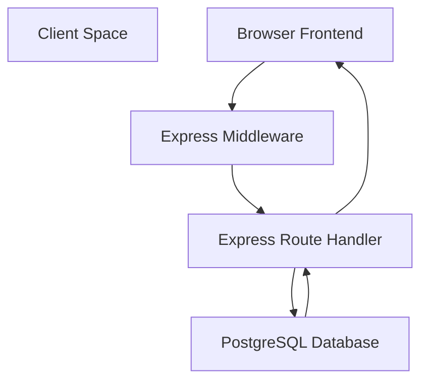

_Figure 1: High-level request pipeline bridging browser actions to database operations._

Sources: `index.js:31-64`[index.js31-64](https://github.com/rhythm162k/my_movie_diary/blob/15be8b17/index.js#L31-L64)`frontend/src/context/AuthContext.jsx:12-27`[frontend/src/context/AuthContext.jsx12-27](https://github.com/rhythm162k/my_movie_diary/blob/15be8b17/frontend/src/context/AuthContext.jsx#L12-L27)

---

## 2. Session Cookies and Authentication Lifecycle

Sessions are managed via `express-session` and persisted in PostgreSQL. When a user authenticates successfully, a session ID cookie named `connect.sid` is dispatched to the browser.

### Session Initialization & Verification

Upon initial application load, `AuthContext` executes a session validation check by querying the backend endpoint `/api/session`[frontend/src/context/AuthContext.jsx12-27](https://github.com/rhythm162k/my_movie_diary/blob/15be8b17/frontend/src/context/AuthContext.jsx#L12-L27):

```
const checkSession = async () => {
  try {
    await axios.get(`${API_URL}/api/session`, {
      withCredentials: true,
    });
    setAuthenticated(true);
  } catch {
    setAuthenticated(false);
  } finally {
    setLoading(false);
  }
};
```

_[frontend/src/context/AuthContext.jsx12-27](https://github.com/rhythm162k/my_movie_diary/blob/15be8b17/frontend/src/context/AuthContext.jsx#L12-L27)_

The Express server inspects `req.session.userId`. If absent, it rejects the request with a `401 Not Authenticated` status; otherwise, it returns the user ID [index.js120-130](https://github.com/rhythm162k/my_movie_diary/blob/15be8b17/index.js#L120-L130)

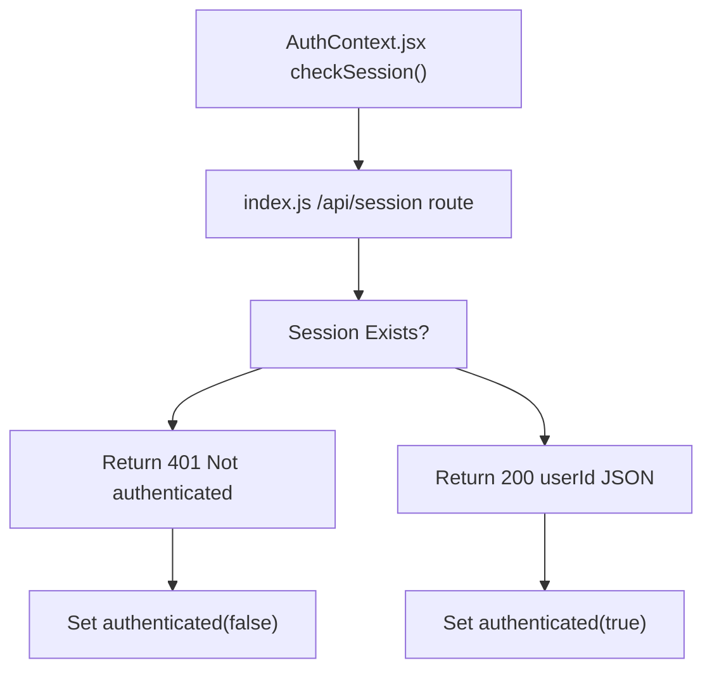

_Title: Session Verification Flow_

Sources: `frontend/src/context/AuthContext.jsx:12-27`[frontend/src/context/AuthContext.jsx12-27](https://github.com/rhythm162k/my_movie_diary/blob/15be8b17/frontend/src/context/AuthContext.jsx#L12-L27)`index.js:120-130`[index.js120-130](https://github.com/rhythm162k/my_movie_diary/blob/15be8b17/index.js#L120-L130)

### Logout Flow

When a user clicks the logout button (`LogoutButton.jsx`), an asynchronous POST request is dispatched to `/api/logout`[frontend/src/Pages/HomePage/LogoutButton.jsx12-26](https://github.com/rhythm162k/my_movie_diary/blob/15be8b17/frontend/src/Pages/HomePage/LogoutButton.jsx#L12-L26) The backend destroys the session store record and clears the cookie [index.js191-207](https://github.com/rhythm162k/my_movie_diary/blob/15be8b17/index.js#L191-L207):

```
app.post("/api/logout", (req, res) => {
  req.session.destroy((error) => {
    if (error) {
      return res.status(500).json({ message: "Could not log out." });
    }
    res.clearCookie("connect.sid");
    res.status(200).json({ message: "Logged out successfully." });
  });
});
```

_[index.js191-207](https://github.com/rhythm162k/my_movie_diary/blob/15be8b17/index.js#L191-L207)_

Sources: `frontend/src/Pages/HomePage/LogoutButton.jsx:12-26`[frontend/src/Pages/HomePage/LogoutButton.jsx12-26](https://github.com/rhythm162k/my_movie_diary/blob/15be8b17/frontend/src/Pages/HomePage/LogoutButton.jsx#L12-L26)`index.js:191-207`[index.js191-207](https://github.com/rhythm162k/my_movie_diary/blob/15be8b17/index.js#L191-L207)

---

## 3. Data Fetching and Mutation Request Flows

User interactions on the `HomePage` trigger asynchronous data synchronization with PostgreSQL.

### Fetching Movies

When `HomePage` mounts or search parameters change, `useEffect` triggers `fetchMovies()`[frontend/src/Pages/HomePage/HomePage.jsx22-53](https://github.com/rhythm162k/my_movie_diary/blob/15be8b17/frontend/src/Pages/HomePage/HomePage.jsx#L22-L53):

1. If a search query is present, it invokes `axios.get(`${API_URL}/api/movies/search?title=...`)`[frontend/src/Pages/HomePage/HomePage.jsx28-34](https://github.com/rhythm162k/my_movie_diary/blob/15be8b17/frontend/src/Pages/HomePage/HomePage.jsx#L28-L34)
2. Otherwise, it retrieves the full movie list via `axios.get(`${API_URL}/api/movies`)`[frontend/src/Pages/HomePage/HomePage.jsx38-40](https://github.com/rhythm162k/my_movie_diary/blob/15be8b17/frontend/src/Pages/HomePage/HomePage.jsx#L38-L40)

The backend route handler validates `req.session.userId`, queries the `movies` table filtered by `userid`, and returns the matching rows [index.js209-230](https://github.com/rhythm162k/my_movie_diary/blob/15be8b17/index.js#L209-L230):

```
app.get("/api/movies", async (req, res) => {
  if (!req.session.userId) {
    return res.status(401).json({ message: "Not authenticated." });
  }
 
  try {
    const result = await db.query(
      "SELECT * FROM movies WHERE userid = $1 ORDER BY id DESC",
      [req.session.userId],
    );
    res.json(result.rows);
  } catch (error) {
    res.status(500).json({ message: "Something went wrong." });
  }
});
```

_[index.js209-230](https://github.com/rhythm162k/my_movie_diary/blob/15be8b17/index.js#L209-L230)_

### Deleting Movies

When a user deletes a movie card, `handleDelete` makes a DELETE request to `/api/delete` passing the `movieId` parameter [frontend/src/Pages/HomePage/HomePage.jsx69-79](https://github.com/rhythm162k/my_movie_diary/blob/15be8b17/frontend/src/Pages/HomePage/HomePage.jsx#L69-L79):

```
const handleDelete = async (movieId) => {
  try {
    await axios.delete(`${API_URL}/api/delete`, {
      params: { id: movieId },
      withCredentials: true,
    });
    setDeleted(!deleted);
  } catch (err) {
    console.log(err);
  }
};
```

_[frontend/src/Pages/HomePage/HomePage.jsx69-79](https://github.com/rhythm162k/my_movie_diary/blob/15be8b17/frontend/src/Pages/HomePage/HomePage.jsx#L69-L79)_

Toggling the `deleted` state forces the `useEffect` hook in `HomePage.jsx` to re-fetch the updated movie list [frontend/src/Pages/HomePage/HomePage.jsx53](https://github.com/rhythm162k/my_movie_diary/blob/15be8b17/frontend/src/Pages/HomePage/HomePage.jsx#L53-L53)

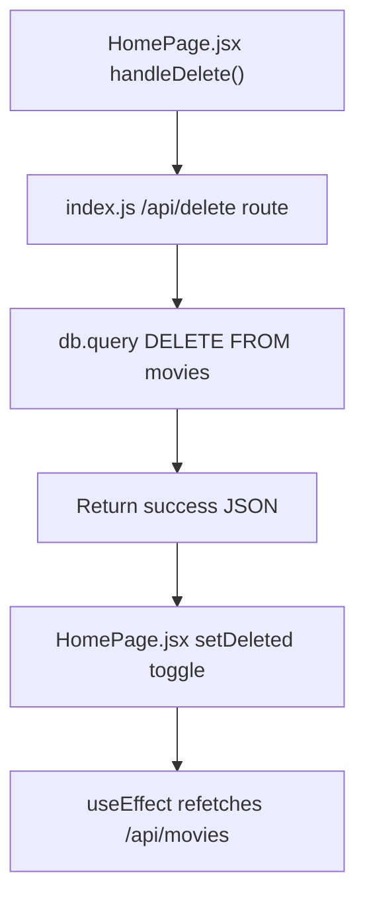

_Title: Movie Deletion Request and State Sync Flow_

Sources: `frontend/src/Pages/HomePage/HomePage.jsx:22-79`[frontend/src/Pages/HomePage/HomePage.jsx22-79](https://github.com/rhythm162k/my_movie_diary/blob/15be8b17/frontend/src/Pages/HomePage/HomePage.jsx#L22-L79)`index.js:209-230`[index.js209-230](https://github.com/rhythm162k/my_movie_diary/blob/15be8b17/index.js#L209-L230)

---

# 2-Backend-Service-(index.js)

# Backend Service (index.js)

Relevant source files

- [index.js](https://github.com/rhythm162k/my_movie_diary/blob/15be8b17/index.js)
- [package-lock.json](https://github.com/rhythm162k/my_movie_diary/blob/15be8b17/package-lock.json)
- [package.json](https://github.com/rhythm162k/my_movie_diary/blob/15be8b17/package.json)

The backend service of **My Movie Diary** is built around a centralized Express application defined in `index.js`. It exposes a RESTful API surface, manages HTTP sessions backed by PostgreSQL, integrates with Google OAuth via Passport.js, and communicates with the OMDb API for movie metadata and poster fetching.

This page provides a high-level overview of the server architecture, middleware pipeline, and routing structure. For detailed deep-dives, refer to the child pages:

- [Authentication & Sessions](/rhythm162k/my_movie_diary/2.1-authentication-and-sessions)
- [Movies API & OMDb Integration](/rhythm162k/my_movie_diary/2.2-movies-api-and-omdb-integration)
- [Data Model & PostgreSQL Access](/rhythm162k/my_movie_diary/2.3-data-model-and-postgresql-access)

---

## Server Architecture & Middleware Stack

The Express application initializes environment configurations using `dotenv` [index.js:12-13] and instantiates an Express router with proxy trust enabled [index.js:14-15]. The core infrastructure relies on a PostgreSQL database client (`pg.Client`) configured via environment variables [index.js:19-27].

The middleware pipeline processes incoming requests sequentially through security, parsing, session management, and authentication layers before routing them to endpoints:

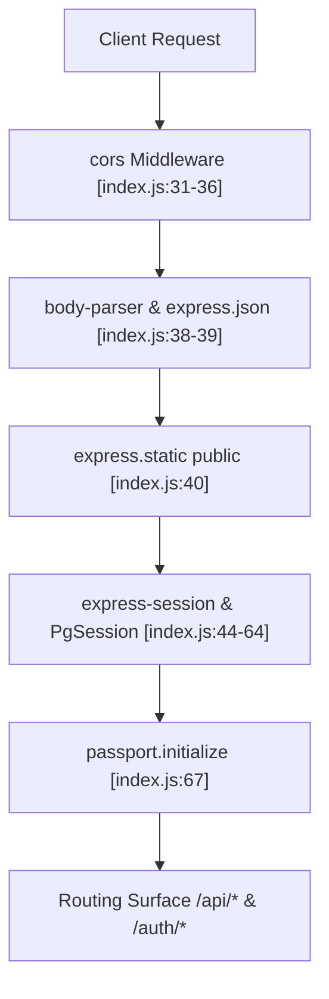

_Sources: [index.js:14-67]_

- **CORS Configuration**: Restricts cross-origin requests to the frontend URL (defaulting to `http://localhost:5173`) with credential sharing enabled [index.js:31-36].
- **Request Parsing**: Parses URL-encoded bodies and JSON payloads [index.js:38-39], and serves static assets from the `public` folder [index.js:40].
- **Session Management**: Implements `express-session` utilizing `connect-pg-simple` as the database store, backed by PostgreSQL session tables [index.js:42-64]. Cookies are secured based on the environment `NODE_ENV` flag [index.js:58-63].
- **Authentication Initialization**: Integrates `passport` middleware to support Google OAuth 2.0 authentication strategies [index.js:67-118].

Sources: [index.js14-118](https://github.com/rhythm162k/my_movie_diary/blob/15be8b17/index.js#L14-L118)

---

## Routing Surface Overview

The Express application exposes authentication, session verification, and movie resource routes.

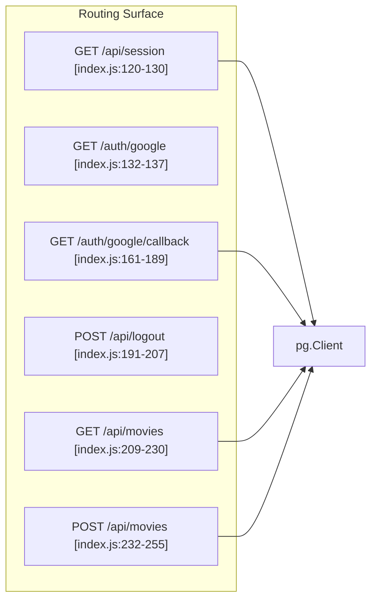

_Sources: [index.js:120-255]_

---

## Sub-Topics & Child Pages

### 2.1 Authentication & Sessions

User management handles both local registration (secured via `bcrypt` with `saltRounds = 15`) and third-party authentication via Google OAuth 2.0. Sessions are persisted across server restarts using `connect-pg-simple`, and endpoints allow clients to inspect session state or terminate sessions safely [index.js:120-207].

- For details, see [Authentication & Sessions](/rhythm162k/my_movie_diary/2.1-authentication-and-sessions).

### 2.2 Movies API & OMDb Integration

The `/api/movies` endpoints handle retrieval and creation of user-specific movie records [index.js:209-255]. The backend checks for duplicate submissions using case-insensitive title matching [index.js:241-250], queries the OMDb API using the configured `apiKey` [index.js:29], and applies a fallback poster when external data is unavailable [index.js:252-255].

- For details, see [Movies API & OMDb Integration](/rhythm162k/my_movie_diary/2.2-movies-api-and-omdb-integration).

### 2.3 Data Model & PostgreSQL Access

Data persistence is managed through direct queries via `pg.Client` [index.js:19-27]. The relational schema supports user authentication identities, session storage (`session` table via `connect-pg-simple`), and relational movie mappings linked via foreign keys (`userid`) [index.js:84-109, index.js:217-219].

- For details, see [Data Model & PostgreSQL Access](/rhythm162k/my_movie_diary/2.3-data-model-and-postgresql-access).

Sources: `[index.js:19-27]`, `[index.js:84-109]`, [index.js120-255](https://github.com/rhythm162k/my_movie_diary/blob/15be8b17/index.js#L120-L255)

---

# 2.1-Authentication-&-Sessions

# Authentication & Sessions

Relevant source files

- [index.js](https://github.com/rhythm162k/my_movie_diary/blob/15be8b17/index.js)

This page covers the authentication and session management subsystem of the backend server (`index.js`). It details credential handling, Google OAuth 2.0 integration via Passport.js, persistent session storage using `express-session` backed by PostgreSQL (`connect-pg-simple`), and the session validation and termination endpoints (`/api/session` and `/api/logout`).

---

## 1. Express Session & PostgreSQL Store Configuration

The server relies on `express-session` combined with `connect-pg-simple` to store active user sessions directly inside PostgreSQL [index.js7-8](https://github.com/rhythm162k/my_movie_diary/blob/15be8b17/index.js#L7-L8)[index.js42-64](https://github.com/rhythm162k/my_movie_diary/blob/15be8b17/index.js#L42-L64)

The session store is initialized using the application's PostgreSQL connection parameters [index.js46-54](https://github.com/rhythm162k/my_movie_diary/blob/15be8b17/index.js#L46-L54) The session cookie is configured with environment-aware flags: `httpOnly` is enabled to mitigate cross-site scripting (XSS) risks, `secure` evaluates to true in production environments, and `sameSite` switches between `"lax"` and `"none"` depending on whether the application is running in production [index.js58-63](https://github.com/rhythm162k/my_movie_diary/blob/15be8b17/index.js#L58-L63) Additionally, the application trusts the proxy upstream [index.js15](https://github.com/rhythm162k/my_movie_diary/blob/15be8b17/index.js#L15-L15)

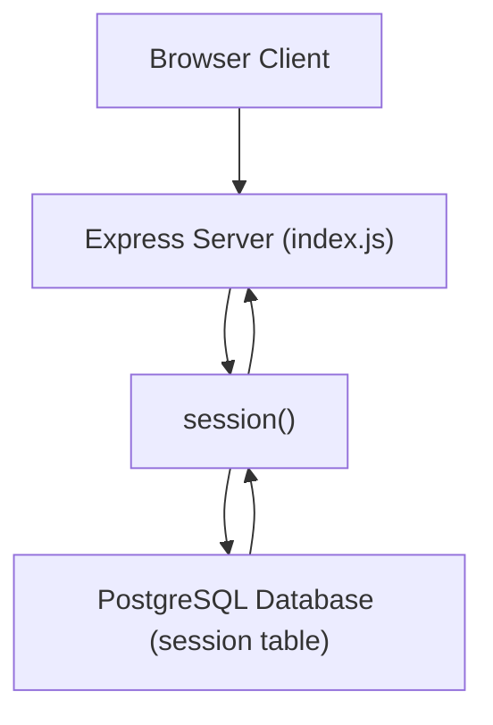

**Sources:**`[index.js:7-8]`, `[index.js:15]`, [index.js42-64](https://github.com/rhythm162k/my_movie_diary/blob/15be8b17/index.js#L42-L64)

---

## 2. Google OAuth 2.0 Integration via Passport.js

Authentication via Google is implemented using `passport` and `passport-google-oauth20`[index.js9-10](https://github.com/rhythm162k/my_movie_diary/blob/15be8b17/index.js#L9-L10) Passport is initialized in the middleware chain [index.js67](https://github.com/rhythm162k/my_movie_diary/blob/15be8b17/index.js#L67-L67) and the `GoogleStrategy` is configured with client credentials and a callback URL from environment variables [index.js69-75](https://github.com/rhythm162k/my_movie_diary/blob/15be8b17/index.js#L69-L75)

When a user completes the Google sign-in flow, the strategy verify callback receives the user's profile [index.js77-82](https://github.com/rhythm162k/my_movie_diary/blob/15be8b17/index.js#L77-L82) It checks the PostgreSQL `users` database to see if a record already exists matching either the `googleid` or the user's `email`[index.js84-101](https://github.com/rhythm162k/my_movie_diary/blob/15be8b17/index.js#L84-L101) If no record is found, a new user row is inserted and the newly generated `userid` is returned [index.js104-111](https://github.com/rhythm162k/my_movie_diary/blob/15be8b17/index.js#L104-L111)

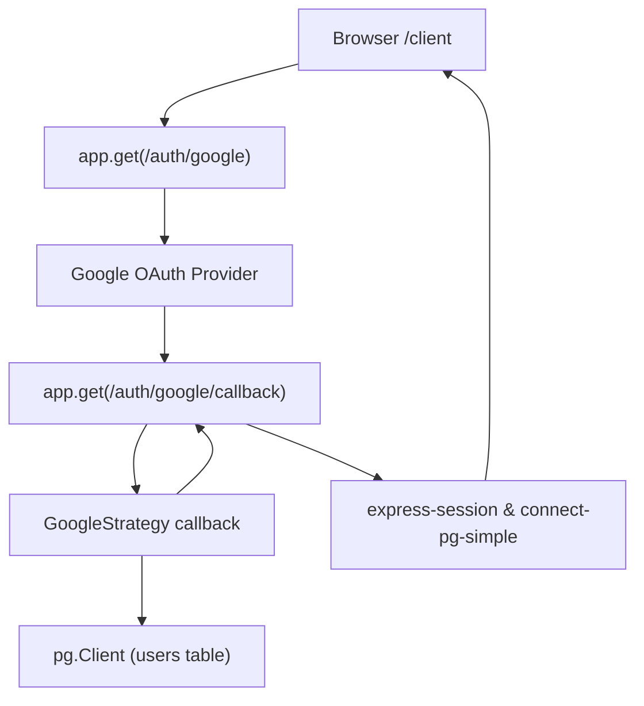

**Sources:**`[index.js:9-10]`, `[index.js:67-118]`, `[index.js:132-137]`, [index.js161-189](https://github.com/rhythm162k/my_movie_diary/blob/15be8b17/index.js#L161-L189)

---

## 3. Session & Logout Endpoints

Session checking and logout are exposed as REST endpoints:

- **`GET /api/session`**: Validates whether `req.session.userId` is present [index.js120-130](https://github.com/rhythm162k/my_movie_diary/blob/15be8b17/index.js#L120-L130) If missing, it responds with status `401` and a message `"Not authenticated."`[index.js121-125](https://github.com/rhythm162k/my_movie_diary/blob/15be8b17/index.js#L121-L125) Otherwise, it returns status `200` with the stored `userId`[index.js127-129](https://github.com/rhythm162k/my_movie_diary/blob/15be8b17/index.js#L127-L129)
- **`POST /api/logout`**: Destroys the active session using `req.session.destroy()`[index.js191-192](https://github.com/rhythm162k/my_movie_diary/blob/15be8b17/index.js#L191-L192) clears the `connect.sid` cookie from the client via `res.clearCookie()`[index.js201](https://github.com/rhythm162k/my_movie_diary/blob/15be8b17/index.js#L201-L201) and returns a success payload [index.js203-206](https://github.com/rhythm162k/my_movie_diary/blob/15be8b17/index.js#L203-L206)

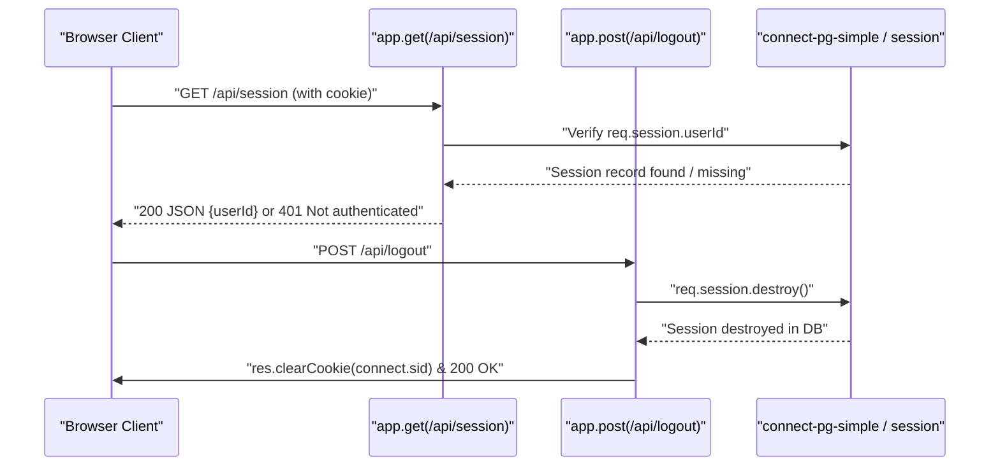

**Sources:**`[index.js:120-130]`, [index.js191-207](https://github.com/rhythm162k/my_movie_diary/blob/15be8b17/index.js#L191-L207)

---

# 2.2-Movies-API-&-OMDb-Integration

# Movies API & OMDb Integration

Relevant source files

- [index.js](https://github.com/rhythm162k/my_movie_diary/blob/15be8b17/index.js)

## Purpose and Scope

This section covers the implementation of the movie management endpoints (`GET /api/movies`, `POST /api/movies`) and related features within the Express server [index.js209-255](https://github.com/rhythm162k/my_movie_diary/blob/15be8b17/index.js#L209-L255) It details session-based authentication checks, case-insensitive duplicate detection, OMDb poster lookups, and fallback poster assignment [index.js209-255](https://github.com/rhythm162k/my_movie_diary/blob/15be8b17/index.js#L209-L255)

---

## Movie Endpoints & Authentication

All movie-related routes require an active session containing a valid `userId`[index.js209-214](https://github.com/rhythm162k/my_movie_diary/blob/15be8b17/index.js#L209-L214)[index.js232-237](https://github.com/rhythm162k/my_movie_diary/blob/15be8b17/index.js#L232-L237) If the session is missing or unauthenticated, the server responds with a `401 Unauthorized` status code [index.js210-213](https://github.com/rhythm162k/my_movie_diary/blob/15be8b17/index.js#L210-L213)[index.js233-236](https://github.com/rhythm162k/my_movie_diary/blob/15be8b17/index.js#L233-L236)

### `GET /api/movies`

The `GET /api/movies` endpoint retrieves all movie records associated with the authenticated user, ordered by their unique identifier in descending order [index.js209-230](https://github.com/rhythm162k/my_movie_diary/blob/15be8b17/index.js#L209-L230)

```
app.get("/api/movies", async (req, res) => {
  if (!req.session.userId) {
    return res.status(401).json({ message: "Not authenticated." });
  }
  // ... queries database for movies by userid ...
});
```

### `POST /api/movies`

The `POST /api/movies` endpoint accepts movie creation payloads (`title`, `description`, `rating`) [index.js239](https://github.com/rhythm162k/my_movie_diary/blob/15be8b17/index.js#L239-L239) checks for duplicates [index.js241-250](https://github.com/rhythm162k/my_movie_diary/blob/15be8b17/index.js#L241-L250) and initiates poster resolution via OMDb using a fallback URL [index.js252-255](https://github.com/rhythm162k/my_movie_diary/blob/15be8b17/index.js#L252-L255)

Sources: [index.js209-255](https://github.com/rhythm162k/my_movie_diary/blob/15be8b17/index.js#L209-L255)

---

## Duplicate Detection

To prevent users from adding the same movie multiple times, the `POST /api/movies` handler performs a case-insensitive lookup against the database using `lower(title)` restricted by the current `userid`[index.js241-244](https://github.com/rhythm162k/my_movie_diary/blob/15be8b17/index.js#L241-L244)

If an existing record is located, the endpoint short-circuits and returns a `409 Conflict` response with an explanatory message [index.js246-250](https://github.com/rhythm162k/my_movie_diary/blob/15be8b17/index.js#L246-L250):

```
const existingMovie = await db.query(
  "SELECT id FROM movies WHERE userid = $1 AND lower(title) = lower($2)",
  [req.session.userId, title],
);
 
if (existingMovie.rows.length > 0) {
  return res.status(409).json({
    message: "You Already Added the Movie :)",
  });
}
```

Sources: [index.js241-250](https://github.com/rhythm162k/my_movie_diary/blob/15be8b17/index.js#L241-L250)

---

## OMDb Poster Lookup & Fallback Poster

When a movie does not already exist in the user's collection, the server prepares a default poster URL (`fallbackPoster`) [index.js252-255](https://github.com/rhythm162k/my_movie_diary/blob/15be8b17/index.js#L252-L255) to ensure UI consistency if external poster retrieval fails or if no match is found via the OMDb API service (`apiKey`) [index.js29](https://github.com/rhythm162k/my_movie_diary/blob/15be8b17/index.js#L29-L29)

```
const fallbackPoster =
  "https://cdn.displate.com/artwork/735x1024/2022-04-15/7422bfe15b3ea7b5933dffd896e9c7f9_46003a1b7353dc7b5a02949bd074432a.jpg";
 
let poster = fallbackPoster;
```

Sources: [index.js29](https://github.com/rhythm162k/my_movie_diary/blob/15be8b17/index.js#L29-L29)[index.js252-255](https://github.com/rhythm162k/my_movie_diary/blob/15be8b17/index.js#L252-L255)

---

## Request Processing Architecture

```

```

Sources: [index.js209-255](https://github.com/rhythm162k/my_movie_diary/blob/15be8b17/index.js#L209-L255)

---

## Code Entity Flow Mapping

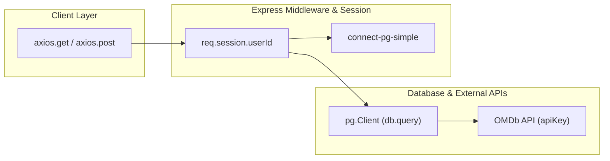

Sources: [index.js7-65](https://github.com/rhythm162k/my_movie_diary/blob/15be8b17/index.js#L7-L65)[index.js209-255](https://github.com/rhythm162k/my_movie_diary/blob/15be8b17/index.js#L209-L255)

---

# 2.3-Data-Model-&-PostgreSQL-Access

# Data Model & PostgreSQL Access

Relevant source files

- [index.js](https://github.com/rhythm162k/my_movie_diary/blob/15be8b17/index.js)
- [package-lock.json](https://github.com/rhythm162k/my_movie_diary/blob/15be8b17/package-lock.json)
- [package.json](https://github.com/rhythm162k/my_movie_diary/blob/15be8b17/package.json)

## Purpose and Scope

This page details the PostgreSQL database architecture, connection configuration, schema design, and query execution patterns used by the Express backend in `index.js`. It covers the configuration of the `pg` client, session persistence via `connect-pg-simple`, and the relational schema supporting users, movies, and HTTP sessions.

Sources: [index.js1-65](https://github.com/rhythm162k/my_movie_diary/blob/15be8b17/index.js#L1-L65)

---

## Environment-Driven PostgreSQL Configuration

The application initializes a PostgreSQL client instance using environment variables managed by `dotenv`. The `pg.Client` configuration reads connection parameters directly from `process.env`, establishing a persistent connection to the database upon startup.

````
const db = new pg.Client({
  user: process.env.PG_USER,
  host: process.env.PG_HOST,
  database: process.env.PG_DATABASE,
  password: process.env.PG_PASSWORD,
  port: process.env.PG_PORT,
});
 
db.connect();
```[index.js:19-27]()
 
Additionally, the session store middleware (`connect-pg-simple`) utilizes an identical configuration object (`conObject`) to persist Express session data directly into PostgreSQL tables, ensuring sessions survive server restarts.
 
```javascript
const PgSession = connectPgSimple(session);
 
app.use(
  session({
    store: new PgSession({
      conObject: {
        user: process.env.PG_USER,
        host: process.env.PG_HOST,
        database: process.env.PG_DATABASE,
        password: process.env.PG_PASSWORD,
        port: process.env.PG_PORT,
      },
    }),
    secret: process.env.SESSION_SECRET,
    // ...
  })
);
```[index.js:42-65]()
 
Sources: <FileRef file-url="https://github.com/rhythm162k/my_movie_diary/blob/15be8b17/index.js#L19-L65" min=19 max=65 file-path="index.js">index.js:19-65</FileRef>
 
---
 
## Database Schema Architecture
The persistence layer comprises three primary tables: `users`, `movies`, and the session store table required by `connect-pg-simple`.
 
```mermaid
graph TD
    sub "Code Entity Space"
        Client["pg.Client"] -->|Executes Queries| DB[(PostgreSQL Database)]
        SessionStore["PgSession (connect-pg-simple)"] -->|Persists Sessions| SessionTable[(session Table)]
    end
 
    sub "Relational Schema Space"
        UsersTable["users Table"] -->|1:N Relationship| MoviesTable["movies Table"]
    end
 
    DB -.-> UsersTable
    DB -.-> MoviesTable
    DB -.-> SessionTable
````

_Figure 1: Database connection architecture mapping `pg.Client` and `PgSession` to underlying relational tables._

Sources: [index.js19-65](https://github.com/rhythm162k/my_movie_diary/blob/15be8b17/index.js#L19-L65)[index.js84-109](https://github.com/rhythm162k/my_movie_diary/blob/15be8b17/index.js#L84-L109)

### Table Definitions & Relations

1. **`users` Table**: Stores local and Google OAuth user records, tracking identifiers, display names, emails, and `googleid`. Referenced by the `movies` table via `userid`.
2. **`movies` Table**: Stores movie diary entries associated with a specific user (`userid`). Contains fields for movie titles, descriptions, ratings, posters, and timestamps.
3. **`session` Table**: Automatically managed by `connect-pg-simple` to store active session identifiers (`sid`), session data JSON (`sess`), and expiration timestamps (`expire`).

Sources: [index.js84-111](https://github.com/rhythm162k/my_movie_diary/blob/15be8b17/index.js#L84-L111)[index.js217-250](https://github.com/rhythm162k/my_movie_diary/blob/15be8b17/index.js#L217-L250)

---

## Query Patterns & Data Flow

Database interactions in `index.js` rely exclusively on parameterized queries via `db.query()` to prevent SQL injection vulnerabilities. Queries are scoped using session parameters (`req.session.userId`) or OAuth payloads (`googleid`, `email`).

```mermaid
sequenceDiagram
    participant Express as "Express Route (/api/movies)"
    participant PG as "pg.Client (db)"
    participant DB as "PostgreSQL DB"
    Express->>PG: "db.query('SELECT * FROM movies WHERE userid = $1 ORDER BY id DESC', [req.session.userId])"
    PG->>DB: "Execute Parameterized Query"
    DB-->>PG: "Return result.rows"
    PG-->>Express: "Resolved Promise with Rows"
```

_Figure 2: Query execution sequence for retrieving user-specific movie records._

### Key Query Implementations

- **Google OAuth User Lookup & Creation**: Checks for existing users by `googleid` or `email` before inserting a new record and returning `userid`.

````
const existingGoogleUser = await db.query(
  "SELECT userid FROM users WHERE googleid = $1",
  [googleId]
);
```[index.js:84-87]()
````

- **Movie Retrieval**: Scopes queries to the authenticated user and orders results descending by primary key.

````
const result = await db.query(
  "SELECT * FROM movies WHERE userid = $1 ORDER BY id DESC",
  [req.session.userId]
);
```[index.js:217-220]()
````

- **Duplicate Detection**: Performs case-insensitive title validation to prevent duplicate entries per user.

````
const existingMovie = await db.query(
  "SELECT id FROM movies WHERE userid = $1 AND lower(title) = lower($2)",
  [req.session.userId, title]
);
```[index.js:241-244]()
````

Sources: [index.js84-111](https://github.com/rhythm162k/my_movie_diary/blob/15be8b17/index.js#L84-L111)[index.js217-250](https://github.com/rhythm162k/my_movie_diary/blob/15be8b17/index.js#L217-L250)

---

# 3-Frontend-Application

# Frontend Application

Relevant source files

- [frontend/index.html](https://github.com/rhythm162k/my_movie_diary/blob/15be8b17/frontend/index.html)
- [frontend/src/App.jsx](https://github.com/rhythm162k/my_movie_diary/blob/15be8b17/frontend/src/App.jsx)
- [frontend/src/main.jsx](https://github.com/rhythm162k/my_movie_diary/blob/15be8b17/frontend/src/main.jsx)

The frontend application for My Movie Diary is a single-page React client built with Vite, utilizing React Router for navigation and Axios for HTTP communication with the Express backend. The application entrypoint bootstraps global contexts, configures credentials for session handling, and maps routes based on the user's authentication state.

For detailed information on specific modules, refer to the following child pages:

- [Routing & Auth Context](/rhythm162k/my_movie_diary/3.1-routing-and-auth-context)
- [Home Page & Movie List](/rhythm162k/my_movie_diary/3.2-home-page-and-movie-list)
- [Authentication Pages](/rhythm162k/my_movie_diary/3.3-authentication-pages)
- [Add New Movie Page](/rhythm162k/my_movie_diary/3.4-add-new-movie-page)

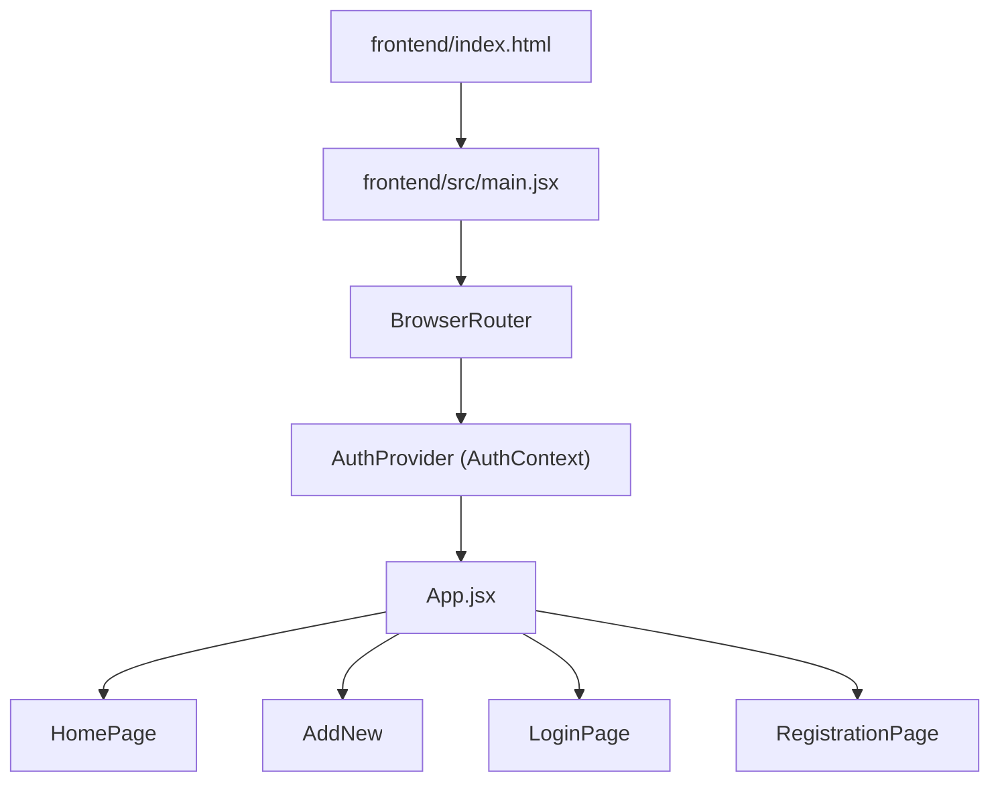

_Diagram 1: Frontend Client Component Hierarchy and Routing Flow_

Sources: `frontend/src/main.jsx:1-18](), [frontend/src/App.jsx:1-57](), [frontend/index.html:1-13]()`

---

## 3.1 Routing & Auth Context

The application entrypoint is defined in `frontend/src/main.jsx`, where global Axios defaults are configured with `axios.defaults.withCredentials = true` to ensure session cookies are transmitted on API requests [frontend/src/main.jsx1-9](https://github.com/rhythm162k/my_movie_diary/blob/15be8b17/frontend/src/main.jsx#L1-L9) The React tree is wrapped in `BrowserRouter` and `AuthProvider` before rendering `App.jsx`[frontend/src/main.jsx10-18](https://github.com/rhythm162k/my_movie_diary/blob/15be8b17/frontend/src/main.jsx#L10-L18)

Inside `frontend/src/App.jsx`, the `useAuth` hook supplies the current `authenticated` state [frontend/src/App.jsx8-9](https://github.com/rhythm162k/my_movie_diary/blob/15be8b17/frontend/src/App.jsx#L8-L9) If the auth state is still loading (`null`), the component returns null [frontend/src/App.jsx11-13](https://github.com/rhythm162k/my_movie_diary/blob/15be8b17/frontend/src/App.jsx#L11-L13) Routes are guarded dynamically: unauthenticated users are redirected to `/login`, while authenticated users accessing public paths are redirected to `/home`[frontend/src/App.jsx16-53](https://github.com/rhythm162k/my_movie_diary/blob/15be8b17/frontend/src/App.jsx#L16-L53)

For deep technical details on route guards, session bootstrapping, and API configuration, see [Routing & Auth Context](/rhythm162k/my_movie_diary/3.1-routing-and-auth-context).

Sources: [frontend/src/main.jsx1-18](https://github.com/rhythm162k/my_movie_diary/blob/15be8b17/frontend/src/main.jsx#L1-L18)[frontend/src/App.jsx1-57](https://github.com/rhythm162k/my_movie_diary/blob/15be8b17/frontend/src/App.jsx#L1-L57)

---

## 3.2 Home Page & Movie List

The `HomePage` component serves as the primary dashboard for authenticated users, displaying their tracked movie list along with search, filtering, and pagination controls.

For detailed breakdowns of sub-components such as `MovieCard`, skeleton loaders, and pagination logic, see [Home Page & Movie List](/rhythm162k/my_movie_diary/3.2-home-page-and-movie-list).

Sources: [frontend/src/App.jsx42-47](https://github.com/rhythm162k/my_movie_diary/blob/15be8b17/frontend/src/App.jsx#L42-L47)

---

## 3.3 Authentication Pages

Authentication interfaces are split across `LoginPage` and `RegistrationPage`, providing form state management, validation, error handling, and Google OAuth sign-in integration.

For complete implementation details on form handling and shared authentication styles, see [Authentication Pages](/rhythm162k/my_movie_diary/3.3-authentication-pages).

Sources: [frontend/src/App.jsx28-40](https://github.com/rhythm162k/my_movie_diary/blob/15be8b17/frontend/src/App.jsx#L28-L40)

---

## 3.4 Add New Movie Page

The `AddNew` page exposes a form for adding new movie records to the user's diary, enforcing rating constraints, handling duplicate entry conflicts (`409`), and interacting with OMDb poster lookup services.

For full details on form inputs, validation rules, and error handling, see [Add New Movie Page](/rhythm162k/my_movie_diary/3.4-add-new-movie-page).

Sources: [frontend/src/App.jsx49-53](https://github.com/rhythm162k/my_movie_diary/blob/15be8b17/frontend/src/App.jsx#L49-L53)

---

# 3.1-Routing-&-Auth-Context

# Routing & Auth Context

Relevant source files

- [frontend/src/App.jsx](https://github.com/rhythm162k/my_movie_diary/blob/15be8b17/frontend/src/App.jsx)
- [frontend/src/Pages/HomePage/LogoutButton.css](https://github.com/rhythm162k/my_movie_diary/blob/15be8b17/frontend/src/Pages/HomePage/LogoutButton.css)
- [frontend/src/Pages/HomePage/LogoutButton.jsx](https://github.com/rhythm162k/my_movie_diary/blob/15be8b17/frontend/src/Pages/HomePage/LogoutButton.jsx)
- [frontend/src/api.js](https://github.com/rhythm162k/my_movie_diary/blob/15be8b17/frontend/src/api.js)
- [frontend/src/context/AuthContext.jsx](https://github.com/rhythm162k/my_movie_diary/blob/15be8b17/frontend/src/context/AuthContext.jsx)
- [frontend/src/main.jsx](https://github.com/rhythm162k/my_movie_diary/blob/15be8b17/frontend/src/main.jsx)

The Routing & Auth Context module handles client-side route protection, global authentication state management via React Context, API endpoint resolution, and session termination. This ensures that unauthenticated users are restricted from accessing private views like the dashboard or movie creation pages, while authenticated sessions persist across page refreshes via HTTP-only cookies.

Sources: `frontend/src/App.jsx:1-57`(), `frontend/src/context/AuthContext.jsx:1-39`()

---

## 1. API Configuration (`api.js`)

The frontend communicates with the Express backend using an environment-driven configuration. The base URL for all HTTP requests is exported from `frontend/src/api.js` by reading Vite's environment variable system.

```
const API_URL = import.meta.env.VITE_API_URL;
```

This `API_URL` constant is imported across authentication and page components to construct absolute paths for API requests.

Sources: `frontend/src/api.js:1-4`()

---

## 2. Authentication Context & Session Bootstrap (`AuthContext.jsx`)

Global authentication state is provided by `AuthProvider` and consumed via the `useAuth` custom hook defined in `frontend/src/context/AuthContext.jsx`.

### State Variables & Initialization

- `authenticated`: A boolean (or null initially) tracking whether a valid server session exists.
- `loading`: A boolean indicating whether the asynchronous session validation check is still pending.

On initial mount, `AuthProvider` uses a `useEffect` hook to execute an asynchronous session verification function (`checkSession`) [frontend/src/context/AuthContext.jsx12-27](https://github.com/rhythm162k/my_movie_diary/blob/15be8b17/frontend/src/context/AuthContext.jsx#L12-L27) This function performs a `GET` request to `${API_URL}/api/session` with `withCredentials: true` to check if the browser holds a valid session cookie [frontend/src/context/AuthContext.jsx15-18](https://github.com/rhythm162k/my_movie_diary/blob/15be8b17/frontend/src/context/AuthContext.jsx#L15-L18)

If the server responds successfully, `setAuthenticated(true)` is invoked [frontend/src/context/AuthContext.jsx18](https://github.com/rhythm162k/my_movie_diary/blob/15be8b17/frontend/src/context/AuthContext.jsx#L18-L18); if it fails (e.g., 401 Unauthorized), `setAuthenticated(false)` is set [frontend/src/context/AuthContext.jsx20](https://github.com/rhythm162k/my_movie_diary/blob/15be8b17/frontend/src/context/AuthContext.jsx#L20-L20) Regardless of outcome, `setLoading(false)` clears the loading flag in the `finally` block [frontend/src/context/AuthContext.jsx21-23](https://github.com/rhythm162k/my_movie_diary/blob/15be8b17/frontend/src/context/AuthContext.jsx#L21-L23) Children components are rendered only after `loading` turns `false`[frontend/src/context/AuthContext.jsx31](https://github.com/rhythm162k/my_movie_diary/blob/15be8b17/frontend/src/context/AuthContext.jsx#L31-L31)

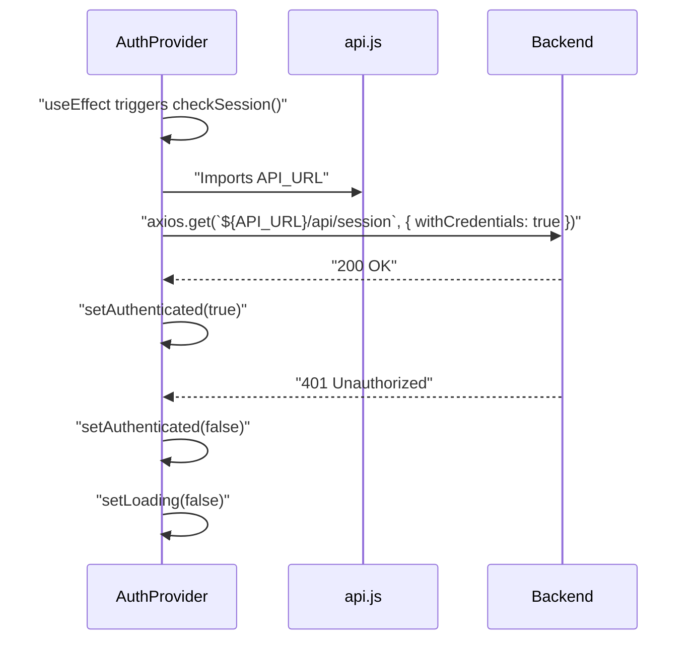

Sources: `frontend/src/context/AuthContext.jsx:1-39`(), `frontend/src/api.js:1-4`()

---

## 3. Route Protection & Guards (`App.jsx` & `main.jsx`)

Global axios configuration in `frontend/src/main.jsx` ensures that credentials (cookies) are automatically attached to cross-origin or same-origin requests:

```
axios.defaults.withCredentials = true;
```

The core routing logic resides in `frontend/src/App.jsx`. The `App` component calls `useAuth()` to retrieve the current `authenticated` status [frontend/src/App.jsx8-9](https://github.com/rhythm162k/my_movie_diary/blob/15be8b17/frontend/src/App.jsx#L8-L9) If `authenticated === null`, `App` renders `null` while waiting for the session bootstrap to finish [frontend/src/App.jsx11-13](https://github.com/rhythm162k/my_movie_diary/blob/15be8b17/frontend/src/App.jsx#L11-L13)

Routes are guarded using conditional ternaries that evaluate `authenticated`:

- **Root (`/`)**: Redirects to `/home` if authenticated, otherwise to `/login`[frontend/src/App.jsx17-26](https://github.com/rhythm162k/my_movie_diary/blob/15be8b17/frontend/src/App.jsx#L17-L26)
- **`/login` & `/registration`**: Guest-only routes. Redirects to `/home` if already authenticated, otherwise renders `LoginPage` or `RegistrationPage`[frontend/src/App.jsx28-40](https://github.com/rhythm162k/my_movie_diary/blob/15be8b17/frontend/src/App.jsx#L28-L40)
- **`/home` & `/add-new`**: Protected routes. Renders `HomePage` or `AddNew` if authenticated, otherwise redirects to `/login`[frontend/src/App.jsx42-52](https://github.com/rhythm162k/my_movie_diary/blob/15be8b17/frontend/src/App.jsx#L42-L52)

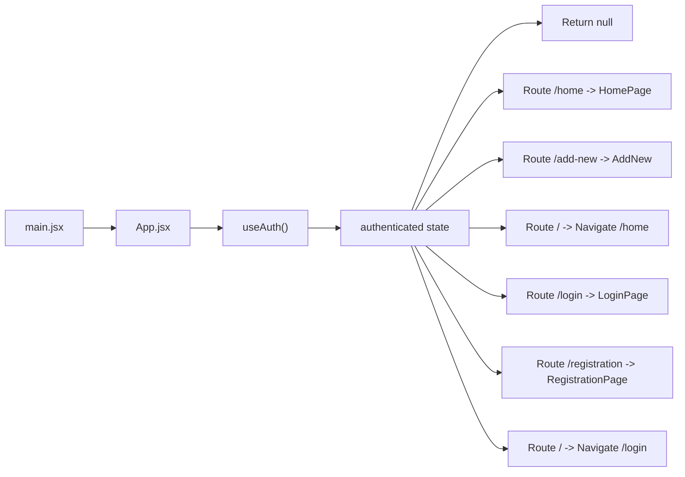

Sources: `frontend/src/App.jsx:1-57`(), `frontend/src/main.jsx:1-19`()

---

## 4. Logout Flow & Component (`LogoutButton.jsx`)

The `LogoutButton` component (`frontend/src/Pages/HomePage/LogoutButton.jsx`) provides an interactive control to terminate the user's session.

### Execution Flow

1. The user clicks the logout button, invoking `handleLogout`[frontend/src/Pages/HomePage/LogoutButton.jsx12](https://github.com/rhythm162k/my_movie_diary/blob/15be8b17/frontend/src/Pages/HomePage/LogoutButton.jsx#L12-L12)
2. An `axios.post` request is sent to `${API_URL}/api/logout` with `withCredentials: true` to clear the server-side session [frontend/src/Pages/HomePage/LogoutButton.jsx14-20](https://github.com/rhythm162k/my_movie_diary/blob/15be8b17/frontend/src/Pages/HomePage/LogoutButton.jsx#L14-L20)
3. `setAuthenticated(false)` is invoked from `useAuth()` to instantly update the React context state [frontend/src/Pages/HomePage/LogoutButton.jsx21](https://github.com/rhythm162k/my_movie_diary/blob/15be8b17/frontend/src/Pages/HomePage/LogoutButton.jsx#L21-L21)
4. `useNavigate()` redirects the client browser to `/login`[frontend/src/Pages/HomePage/LogoutButton.jsx9](https://github.com/rhythm162k/my_movie_diary/blob/15be8b17/frontend/src/Pages/HomePage/LogoutButton.jsx#L9-L9)[frontend/src/Pages/HomePage/LogoutButton.jsx22](https://github.com/rhythm162k/my_movie_diary/blob/15be8b17/frontend/src/Pages/HomePage/LogoutButton.jsx#L22-L22)

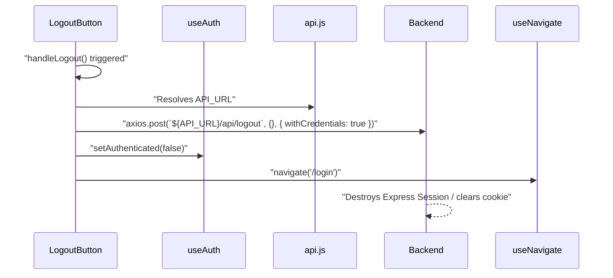

Sources: `frontend/src/Pages/HomePage/LogoutButton.jsx:1-35`(), `frontend/src/Pages/HomePage/LogoutButton.css:1-26`()

---

# 3.2-Home-Page-&-Movie-List

# Home Page & Movie List

Relevant source files

- [frontend/src/Pages/HomePage/HomePage.css](https://github.com/rhythm162k/my_movie_diary/blob/15be8b17/frontend/src/Pages/HomePage/HomePage.css)
- [frontend/src/Pages/HomePage/HomePage.jsx](https://github.com/rhythm162k/my_movie_diary/blob/15be8b17/frontend/src/Pages/HomePage/HomePage.jsx)

The `HomePage` component serves as the central dashboard for authenticated users of My Movie Diary. It provides an overview of the user's movie collection, supports title-based searching via URL query parameters, manages pagination, handles asynchronous deletion of records, and renders appropriate empty or loading states.

Sources: `frontend/src/Pages/HomePage/HomePage.jsx:11-143`, `frontend/src/Pages/HomePage/HomePage.css:1-8`

---

## Dashboard State & Data Fetching

The `HomePage` component manages several pieces of local React state to control UI rendering and data synchronization:

- `movies`: Stores the full array of user movies fetched from the backend.
- `searchResults`: Stores filtered movie results when a search query is active.
- `searchParams`: Utilizes `useSearchParams` from `react-router` to sync search queries with the browser URL `[frontend/src/Pages/HomePage/HomePage.jsx:12-16]`.
- `loading`: A boolean flag toggled during asynchronous network requests `[frontend/src/Pages/HomePage/HomePage.jsx:18]`.
- `deleted`: A toggle state that triggers re-fetching when a movie is deleted `[frontend/src/Pages/HomePage/HomePage.jsx:17]`.

Data fetching is orchestrated inside a `useEffect` hook that listens to changes in `searchParams` and the `deleted` toggle `[frontend/src/Pages/HomePage/HomePage.jsx:22-53]`. Depending on whether a `search` query parameter exists, it issues an Axios GET request to either `${API_URL}/api/movies/search?title=...` or `${API_URL}/api/movies` with credentials included `[frontend/src/Pages/HomePage/HomePage.jsx:28-44]`.

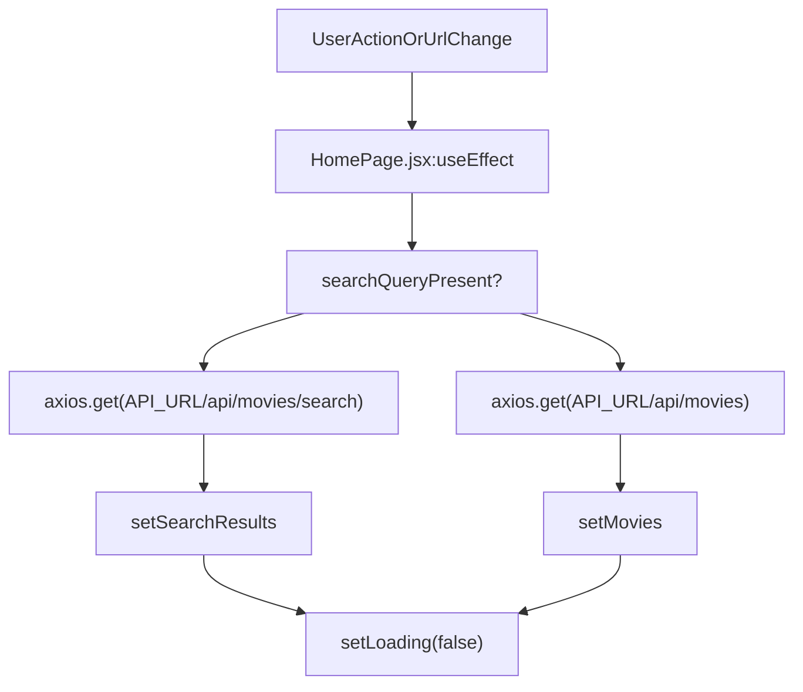

_Figure 1: Data fetching decision flow in `HomePage`._

Sources: `frontend/src/Pages/HomePage/HomePage.jsx:11-53`

---

## Search & Pagination Architecture

The dashboard determines which dataset to display by evaluating `searchResults`. If `searchResults` is not `null`, it takes precedence over the full `movies` array `[frontend/src/Pages/HomePage/HomePage.jsx:55]`.

Pagination is handled client-side using a fixed page size of 10 movies per page (`moviesPerPage = 10`) `[frontend/src/Pages/HomePage/HomePage.jsx:20]`. Total pages, start index, and the current slice of movies are computed dynamically before rendering `[frontend/src/Pages/HomePage/HomePage.jsx:56-61]`:

```
const displayedMovies = searchResults !== null ? searchResults : movies;
const totalPages = Math.ceil(displayedMovies.length / moviesPerPage);
const startIndex = (currentPage - 1) * moviesPerPage;
const paginatedMovies = displayedMovies.slice(startIndex, startIndex + moviesPerPage);
```

When a user submits a search form via `handleSearch`, the current page is reset to `1` and the URL search parameters are updated `[frontend/src/Pages/HomePage/HomePage.jsx:63-67]`.

Sources: `frontend/src/Pages/HomePage/HomePage.jsx:20-20`, `frontend/src/Pages/HomePage/HomePage.jsx:55-67`

---

## Layout, Empty States, & Component Composition

The `HomePage` layout is structured using CSS grid and flexbox rules defined in `HomePage.css`. It features a responsive container with a textured background, a header section with search and add controls, a dynamic main body grid, and a pagination footer `[frontend/src/Pages/HomePage/HomePage.css:1-186]`.

Depending on the current state (`loading`, `paginatedMovies.length`), the main body conditionally renders:

1. Skeleton placeholders (`SkeletonLoad`) when `loading` is true `[frontend/src/Pages/HomePage/HomePage.jsx:112-115]`.
2. Empty state images (`not-found.png` or `not-added.png`) when no movies match the current filter or library `[frontend/src/Pages/HomePage/HomePage.jsx:116-125]`.
3. A grid of `MovieCard` components when movies are available `[frontend/src/Pages/HomePage/HomePage.jsx:126-134]`.

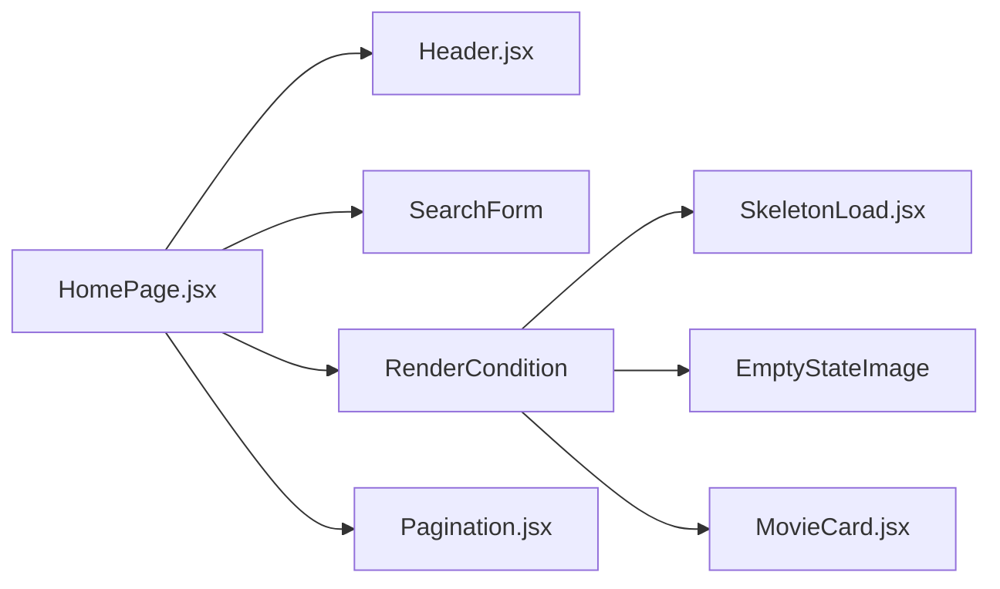

_Figure 2: Component composition and conditional rendering tree._

Sources: `frontend/src/Pages/HomePage/HomePage.jsx:81-141`, `frontend/src/Pages/HomePage/HomePage.css:68-81`

---

## Child Pages Overview

For more granular technical details regarding the child components and sub-systems of the home page, refer to the following child pages:

- **[MovieCard & Header](/rhythm162k/my_movie_diary/3.2.1-moviecard-and-header)** — Covers individual movie record rendering, poster handling, the delete action implementation via Axios, and the `Header` navigation component structure.
- **[Skeleton Loading & Pagination](/rhythm162k/my_movie_diary/3.2.2-skeleton-loading-and-pagination)** — Covers the `SkeletonLoad` component with shimmer animation effects and the `Pagination` control component.

Sources: `frontend/src/Pages/HomePage/HomePage.jsx:4-7`, `frontend/src/Pages/HomePage/HomePage.jsx:69-79`

---

# 3.2.1-MovieCard-&-Header

# MovieCard & Header

Relevant source files

- [frontend/src/Pages/HomePage/Header.css](https://github.com/rhythm162k/my_movie_diary/blob/15be8b17/frontend/src/Pages/HomePage/Header.css)
- [frontend/src/Pages/HomePage/Header.jsx](https://github.com/rhythm162k/my_movie_diary/blob/15be8b17/frontend/src/Pages/HomePage/Header.jsx)
- [frontend/src/Pages/HomePage/MovieCard.css](https://github.com/rhythm162k/my_movie_diary/blob/15be8b17/frontend/src/Pages/HomePage/MovieCard.css)
- [frontend/src/Pages/HomePage/MovieCard.jsx](https://github.com/rhythm162k/my_movie_diary/blob/15be8b17/frontend/src/Pages/HomePage/MovieCard.jsx)

## Purpose and Scope

This section details the implementation of the `MovieCard` and `Header` components within the frontend application. The `MovieCard` component [frontend/src/Pages/HomePage/MovieCard.jsx3-26](https://github.com/rhythm162k/my_movie_diary/blob/15be8b17/frontend/src/Pages/HomePage/MovieCard.jsx#L3-L26) is responsible for presenting individual movie records—including posters, ratings, titles, and personal descriptions—along with triggering deletion workflows. The `Header` component [frontend/src/Pages/HomePage/Header.jsx4-11](https://github.com/rhythm162k/my_movie_diary/blob/15be8b17/frontend/src/Pages/HomePage/Header.jsx#L4-L11) provides top-level branding and navigation controls for the authenticated dashboard.

Sources: [frontend/src/Pages/HomePage/MovieCard.jsx1-26](https://github.com/rhythm162k/my_movie_diary/blob/15be8b17/frontend/src/Pages/HomePage/MovieCard.jsx#L1-L26)[frontend/src/Pages/HomePage/Header.jsx1-11](https://github.com/rhythm162k/my_movie_diary/blob/15be8b17/frontend/src/Pages/HomePage/Header.jsx#L1-L11)

---

## MovieCard Component & Delete Action

The `MovieCard` function component accepts two props: `movie` (an object containing movie metadata) and `handleDelete` (a callback function invoked when removing a record) [frontend/src/Pages/HomePage/MovieCard.jsx3](https://github.com/rhythm162k/my_movie_diary/blob/15be8b17/frontend/src/Pages/HomePage/MovieCard.jsx#L3-L3)

```
+-------------------------------------------------------+
|                   MovieCard.jsx                       |
|  - Renders movie fields (title, rating, description)  |
|  - Displays poster image (movie.imgsrc)               |
|  - Triggers handleDelete(movie.id) via DeleteIcon     |
+-------------------------------------------------------+

```

### Component Structure

- **Poster and Metadata**: Utilizes `movie.imgsrc` for the poster image and renders `movie.title` alongside `movie.rating`[frontend/src/Pages/HomePage/MovieCard.jsx8-13](https://github.com/rhythm162k/my_movie_diary/blob/15be8b17/frontend/src/Pages/HomePage/MovieCard.jsx#L8-L13)
- **Description**: Displays user notes under the heading "My Description:" [frontend/src/Pages/HomePage/MovieCard.jsx17-20](https://github.com/rhythm162k/my_movie_diary/blob/15be8b17/frontend/src/Pages/HomePage/MovieCard.jsx#L17-L20)
- **Delete Button**: Renders a button containing a Material UI `DeleteIcon` (`@mui/icons-material/Delete`), which executes an inline arrow function calling `handleDelete(movie.id)`[frontend/src/Pages/HomePage/MovieCard.jsx21-23](https://github.com/rhythm162k/my_movie_diary/blob/15be8b17/frontend/src/Pages/HomePage/MovieCard.jsx#L21-L23)

Sources: [frontend/src/Pages/HomePage/MovieCard.jsx1-26](https://github.com/rhythm162k/my_movie_diary/blob/15be8b17/frontend/src/Pages/HomePage/MovieCard.jsx#L1-L26)

---

## Header Component

The `Header` component renders the top navigation bar of the dashboard [frontend/src/Pages/HomePage/Header.jsx4-11](https://github.com/rhythm162k/my_movie_diary/blob/15be8b17/frontend/src/Pages/HomePage/Header.jsx#L4-L11) It houses the main application logo (`app-logo.png`) and embeds the `LogoutButton` component to handle session termination [frontend/src/Pages/HomePage/Header.jsx7-8](https://github.com/rhythm162k/my_movie_diary/blob/15be8b17/frontend/src/Pages/HomePage/Header.jsx#L7-L8)

```
+-------------------------------------------------------+
|                    Header.jsx                         |
|  - Renders ".header-element" container                |
|  - Displays app logo image ("./app-logo.png")         |
|  - Embeds <LogoutButton />                            |
+-------------------------------------------------------+

```

Sources: [frontend/src/Pages/HomePage/Header.jsx1-11](https://github.com/rhythm162k/my_movie_diary/blob/15be8b17/frontend/src/Pages/HomePage/Header.jsx#L1-L11)[frontend/src/Pages/HomePage/Header.css1-7](https://github.com/rhythm162k/my_movie_diary/blob/15be8b17/frontend/src/Pages/HomePage/Header.css#L1-L7)

---

## Styles & Responsive Layout

Visual styling for `MovieCard` and `Header` is defined in dedicated CSS modules using CSS custom properties for consistency across themes.

### MovieCard Styling (`MovieCard.css`)

- **Grid Layout**: The `.movie` container uses a 3-row grid (`auto 1fr auto`) with a border radius of `12px` and `var(--border)` background color [frontend/src/Pages/HomePage/MovieCard.css1-8](https://github.com/rhythm162k/my_movie_diary/blob/15be8b17/frontend/src/Pages/HomePage/MovieCard.css#L1-L8)
- **Hover Transitions**: Card elevation is enhanced on hover via `transform`, `box-shadow`, and `border-color` transitions [frontend/src/Pages/HomePage/MovieCard.css9-19](https://github.com/rhythm162k/my_movie_diary/blob/15be8b17/frontend/src/Pages/HomePage/MovieCard.css#L9-L19)
- **Poster Grid**: The inner `.movie-poster-description` applies a two-column grid (`120px 1fr`) separating the poster image from the title and rating [frontend/src/Pages/HomePage/MovieCard.css23-28](https://github.com/rhythm162k/my_movie_diary/blob/15be8b17/frontend/src/Pages/HomePage/MovieCard.css#L23-L28)
- **Delete Button Interactions**: The `.delete-btn` element aligns to the bottom-right and shifts to a red accent color (`#ff5c5c`) with a light background tint on hover [frontend/src/Pages/HomePage/MovieCard.css78-102](https://github.com/rhythm162k/my_movie_diary/blob/15be8b17/frontend/src/Pages/HomePage/MovieCard.css#L78-L102)
- **Responsive Breakpoints**:

- Tablet (`max-width: 960px`): Collapses poster and title into a single-column centered layout [frontend/src/Pages/HomePage/MovieCard.css106-125](https://github.com/rhythm162k/my_movie_diary/blob/15be8b17/frontend/src/Pages/HomePage/MovieCard.css#L106-L125)
- Mobile (`max-width: 615px`): Reduces padding and poster dimensions [frontend/src/Pages/HomePage/MovieCard.css129-141](https://github.com/rhythm162k/my_movie_diary/blob/15be8b17/frontend/src/Pages/HomePage/MovieCard.css#L129-L141)

### Header Styling (`Header.css`)

- **Header Container**: `.header-element` uses flexbox with `space-between` alignment, a maximum width of `1200px`, and standard vertical margins [frontend/src/Pages/HomePage/Header.css1-7](https://github.com/rhythm162k/my_movie_diary/blob/15be8b17/frontend/src/Pages/HomePage/Header.css#L1-L7)
- **Logo Size**: Constrains the application logo image width to `250px`[frontend/src/Pages/HomePage/Header.css9-11](https://github.com/rhythm162k/my_movie_diary/blob/15be8b17/frontend/src/Pages/HomePage/Header.css#L9-L11)

Sources: [frontend/src/Pages/HomePage/MovieCard.css1-141](https://github.com/rhythm162k/my_movie_diary/blob/15be8b17/frontend/src/Pages/HomePage/MovieCard.css#L1-L141)[frontend/src/Pages/HomePage/Header.css1-11](https://github.com/rhythm162k/my_movie_diary/blob/15be8b17/frontend/src/Pages/HomePage/Header.css#L1-L11)

---

# 3.2.2-Skeleton-Loading-&-Pagination

# Skeleton Loading & Pagination

Relevant source files

- [frontend/src/Pages/HomePage/SkeletonLoad.css](https://github.com/rhythm162k/my_movie_diary/blob/15be8b17/frontend/src/Pages/HomePage/SkeletonLoad.css)
- [frontend/src/Pages/HomePage/SkeletonLoad.jsx](https://github.com/rhythm162k/my_movie_diary/blob/15be8b17/frontend/src/Pages/HomePage/SkeletonLoad.jsx)
- [frontend/src/components/Pagination.css](https://github.com/rhythm162k/my_movie_diary/blob/15be8b17/frontend/src/components/Pagination.css)
- [frontend/src/components/Pagination.jsx](https://github.com/rhythm162k/my_movie_diary/blob/15be8b17/frontend/src/components/Pagination.jsx)

This page details the implementation of the asynchronous loading placeholder component (`SkeletonLoad`) featuring CSS-driven shimmer animations, and the page navigation component (`Pagination`), both used within the movie diary dashboard interface.

---

## 1. SkeletonLoad Component & Shimmer Animation

The `SkeletonLoad` component provides a structural placeholder during asynchronous data fetching (such as loading movie lists on the `HomePage`). It mirrors the layout dimensions of actual movie cards to prevent layout shifts.

### Component Structure

`SkeletonLoad` is defined as a stateless functional component in [frontend/src/Pages/HomePage/SkeletonLoad.jsx1-19](https://github.com/rhythm162k/my_movie_diary/blob/15be8b17/frontend/src/Pages/HomePage/SkeletonLoad.jsx#L1-L19):

- It renders a outer container `div` with the class `skeleton-movie`[frontend/src/Pages/HomePage/SkeletonLoad.jsx4](https://github.com/rhythm162k/my_movie_diary/blob/15be8b17/frontend/src/Pages/HomePage/SkeletonLoad.jsx#L4-L4)
- Inside, it contains a `.skeleton-movie-poster-description` wrapper housing a placeholder poster (`.skeleton-movie-img`) [frontend/src/Pages/HomePage/SkeletonLoad.jsx5-6](https://github.com/rhythm162k/my_movie_diary/blob/15be8b17/frontend/src/Pages/HomePage/SkeletonLoad.jsx#L5-L6) and title/rating blocks (`.title`, `.rating`) [frontend/src/Pages/HomePage/SkeletonLoad.jsx8-11](https://github.com/rhythm162k/my_movie_diary/blob/15be8b17/frontend/src/Pages/HomePage/SkeletonLoad.jsx#L8-L11)
- A description section (`.skeleton-description-box`) sits at the bottom [frontend/src/Pages/HomePage/SkeletonLoad.jsx14-16](https://github.com/rhythm162k/my_movie_diary/blob/15be8b17/frontend/src/Pages/HomePage/SkeletonLoad.jsx#L14-L16)

### Shimmer Animation Styles

The shimmer effect is achieved using pure CSS in [frontend/src/Pages/HomePage/SkeletonLoad.css1-103](https://github.com/rhythm162k/my_movie_diary/blob/15be8b17/frontend/src/Pages/HomePage/SkeletonLoad.css#L1-L103)

- Pseudo-elements (`::before`) are applied to `.title`, `.rating`, `.skeleton-description-box`, and `.skeleton-movie-img`[frontend/src/Pages/HomePage/SkeletonLoad.css80-83](https://github.com/rhythm162k/my_movie_diary/blob/15be8b17/frontend/src/Pages/HomePage/SkeletonLoad.css#L80-L83)
- A linear gradient background moving horizontally via the `@keyframes shimmer` animation produces the sweeping light effect [frontend/src/Pages/HomePage/SkeletonLoad.css88-103](https://github.com/rhythm162k/my_movie_diary/blob/15be8b17/frontend/src/Pages/HomePage/SkeletonLoad.css#L88-L103)

_Sources: [frontend/src/Pages/HomePage/SkeletonLoad.jsx1-19](https://github.com/rhythm162k/my_movie_diary/blob/15be8b17/frontend/src/Pages/HomePage/SkeletonLoad.jsx#L1-L19)[frontend/src/Pages/HomePage/SkeletonLoad.css1-103](https://github.com/rhythm162k/my_movie_diary/blob/15be8b17/frontend/src/Pages/HomePage/SkeletonLoad.css#L1-L103)_

---

## 2. Pagination Component & Page Navigation Logic

The `Pagination` component renders numerical page buttons and ellipsis markers to control large datasets across multiple pages.

### Component Props & Guard

`Pagination` accepts three props: `currentPage`, `totalPages`, and `onPageChange`[frontend/src/components/Pagination.jsx3](https://github.com/rhythm162k/my_movie_diary/blob/15be8b17/frontend/src/components/Pagination.jsx#L3-L3) If `totalPages` is less than or equal to `1`, the component returns `null` and renders nothing [frontend/src/components/Pagination.jsx4-6](https://github.com/rhythm162k/my_movie_diary/blob/15be8b17/frontend/src/components/Pagination.jsx#L4-L6)

### Page Number Generation (`getPageNumbers`)

The helper function `getPageNumbers()` constructs an array of page numbers or ellipsis strings (`"..."`) depending on the total page count and current position [frontend/src/components/Pagination.jsx8-48](https://github.com/rhythm162k/my_movie_diary/blob/15be8b17/frontend/src/components/Pagination.jsx#L8-L48):

- **Small datasets (`totalPages <= 7`)**: Returns a sequential array from `1` to `totalPages`[frontend/src/components/Pagination.jsx11-17](https://github.com/rhythm162k/my_movie_diary/blob/15be8b17/frontend/src/components/Pagination.jsx#L11-L17)
- **Near the beginning (`currentPage <= 4`)**: Displays pages `1` through `5`, an ellipsis, and `totalPages`[frontend/src/components/Pagination.jsx21-27](https://github.com/rhythm162k/my_movie_diary/blob/15be8b17/frontend/src/components/Pagination.jsx#L21-L27)
- **Near the end (`currentPage >= totalPages - 3`)**: Displays page `1`, an ellipsis, and the final 5 pages [frontend/src/components/Pagination.jsx29-40](https://github.com/rhythm162k/my_movie_diary/blob/15be8b17/frontend/src/components/Pagination.jsx#L29-L40)
- **Middle ranges**: Displays page `1`, an ellipsis, `currentPage - 1`, `currentPage`, `currentPage + 1`, an ellipsis, and `totalPages`[frontend/src/components/Pagination.jsx42-47](https://github.com/rhythm162k/my_movie_diary/blob/15be8b17/frontend/src/components/Pagination.jsx#L42-L47)

### Event Handling & Styling

Buttons invoke `onPageChange(page)` when clicked [frontend/src/components/Pagination.jsx66](https://github.com/rhythm162k/my_movie_diary/blob/15be8b17/frontend/src/components/Pagination.jsx#L66-L66) The active button receives the `.active` CSS class [frontend/src/components/Pagination.jsx63-65](https://github.com/rhythm162k/my_movie_diary/blob/15be8b17/frontend/src/components/Pagination.jsx#L63-L65) Styles are defined in [frontend/src/components/Pagination.css1-68](https://github.com/rhythm162k/my_movie_diary/blob/15be8b17/frontend/src/components/Pagination.css#L1-L68), utilizing CSS custom properties for theme integration and responsive breakpoints for mobile displays [frontend/src/components/Pagination.css55-68](https://github.com/rhythm162k/my_movie_diary/blob/15be8b17/frontend/src/components/Pagination.css#L55-L68)

_Sources: [frontend/src/components/Pagination.jsx3-76](https://github.com/rhythm162k/my_movie_diary/blob/15be8b17/frontend/src/components/Pagination.jsx#L3-L76)[frontend/src/components/Pagination.css1-68](https://github.com/rhythm162k/my_movie_diary/blob/15be8b17/frontend/src/components/Pagination.css#L1-L68)_

---

## 3. Component Interaction & Rendering Flow

The following diagram illustrates how the `HomePage` transitions between rendering `SkeletonLoad` items during data fetching and the `Pagination` component once data and page counts are established.

_Sources: [frontend/src/Pages/HomePage/SkeletonLoad.jsx1-19](https://github.com/rhythm162k/my_movie_diary/blob/15be8b17/frontend/src/Pages/HomePage/SkeletonLoad.jsx#L1-L19)[frontend/src/components/Pagination.jsx3-76](https://github.com/rhythm162k/my_movie_diary/blob/15be8b17/frontend/src/components/Pagination.jsx#L3-L76) _

---

# 3.3-Authentication-Pages

# Authentication Pages

Relevant source files

- [frontend/public/app-logo.png](https://github.com/rhythm162k/my_movie_diary/blob/15be8b17/frontend/public/app-logo.png)
- [frontend/src/Pages/LoginRegistration/Divider.css](https://github.com/rhythm162k/my_movie_diary/blob/15be8b17/frontend/src/Pages/LoginRegistration/Divider.css)
- [frontend/src/Pages/LoginRegistration/GoogleBTN.css](https://github.com/rhythm162k/my_movie_diary/blob/15be8b17/frontend/src/Pages/LoginRegistration/GoogleBTN.css)
- [frontend/src/Pages/LoginRegistration/GoogleBTN.jsx](https://github.com/rhythm162k/my_movie_diary/blob/15be8b17/frontend/src/Pages/LoginRegistration/GoogleBTN.jsx)
- [frontend/src/Pages/LoginRegistration/LoginPage.css](https://github.com/rhythm162k/my_movie_diary/blob/15be8b17/frontend/src/Pages/LoginRegistration/LoginPage.css)
- [frontend/src/Pages/LoginRegistration/LoginPage.jsx](https://github.com/rhythm162k/my_movie_diary/blob/15be8b17/frontend/src/Pages/LoginRegistration/LoginPage.jsx)
- [frontend/src/Pages/LoginRegistration/RegistrationPage.css](https://github.com/rhythm162k/my_movie_diary/blob/15be8b17/frontend/src/Pages/LoginRegistration/RegistrationPage.css)
- [frontend/src/Pages/LoginRegistration/RegistrationPage.jsx](https://github.com/rhythm162k/my_movie_diary/blob/15be8b17/frontend/src/Pages/LoginRegistration/RegistrationPage.jsx)

## Purpose and Scope

This page documents the technical architecture, state management, validation rules, error handling workflows, and styling implementations for `LoginPage` and `RegistrationPage`. These components constitute the client-side entry points for user authentication, handling traditional email/password credentials as well as delegated Google OAuth sign-in.

Sources:

- `frontend/src/Pages/LoginRegistration/LoginPage.jsx`[frontend/src/Pages/LoginRegistration/LoginPage.jsx1-120](https://github.com/rhythm162k/my_movie_diary/blob/15be8b17/frontend/src/Pages/LoginRegistration/LoginPage.jsx#L1-L120)
- `frontend/src/Pages/LoginRegistration/RegistrationPage.jsx`[frontend/src/Pages/LoginRegistration/RegistrationPage.jsx1-158](https://github.com/rhythm162k/my_movie_diary/blob/15be8b17/frontend/src/Pages/LoginRegistration/RegistrationPage.jsx#L1-L158)

---

## 1. LoginPage Implementation & Data Flow

The `LoginPage` component renders a centered card layout containing an app logo, an email/password form, a visual divider, and a Google OAuth sign-in trigger [frontend/src/Pages/LoginRegistration/LoginPage.jsx51-117](https://github.com/rhythm162k/my_movie_diary/blob/15be8b17/frontend/src/Pages/LoginRegistration/LoginPage.jsx#L51-L117)

### Form State and Change Handling

Local component state is maintained via React `useState` hooks for input fields (`loginData`), request execution status (`loading`), and user-facing error messages (`error`) [frontend/src/Pages/LoginRegistration/LoginPage.jsx11-20](https://github.com/rhythm162k/my_movie_diary/blob/15be8b17/frontend/src/Pages/LoginRegistration/LoginPage.jsx#L11-L20) The `handleChange` function uses computed property names to dynamically bind input values to the `loginData` state object [frontend/src/Pages/LoginRegistration/LoginPage.jsx22-28](https://github.com/rhythm162k/my_movie_diary/blob/15be8b17/frontend/src/Pages/LoginRegistration/LoginPage.jsx#L22-L28)

_Figure 1: LoginPage submission flow connecting React event handlers to Express authentication endpoints._

Sources:

- `frontend/src/Pages/LoginRegistration/LoginPage.jsx`[frontend/src/Pages/LoginRegistration/LoginPage.jsx11-50](https://github.com/rhythm162k/my_movie_diary/blob/15be8b17/frontend/src/Pages/LoginRegistration/LoginPage.jsx#L11-L50)

---

## 2. RegistrationPage Implementation & Data Flow

The `RegistrationPage` component provides user onboarding capabilities, accepting a full name, email, password, and password confirmation [frontend/src/Pages/LoginRegistration/RegistrationPage.jsx11-123](https://github.com/rhythm162k/my_movie_diary/blob/15be8b17/frontend/src/Pages/LoginRegistration/RegistrationPage.jsx#L11-L123)

### Client-Side Validation

Before transmitting registration payloads to the backend, `handleSubmit` performs client-side validation to verify that `password` matches `confirmPassword`[frontend/src/Pages/LoginRegistration/RegistrationPage.jsx32-39](https://github.com/rhythm162k/my_movie_diary/blob/15be8b17/frontend/src/Pages/LoginRegistration/RegistrationPage.jsx#L32-L39) If a mismatch is detected, execution halts, and `setError("Password didn't match")` is triggered [frontend/src/Pages/LoginRegistration/RegistrationPage.jsx36-38](https://github.com/rhythm162k/my_movie_diary/blob/15be8b17/frontend/src/Pages/LoginRegistration/RegistrationPage.jsx#L36-L38)

### Registration API Interaction

If validation succeeds, an HTTP `POST` request is sent to `${API_URL}/api/registration` with credentials enabled [frontend/src/Pages/LoginRegistration/RegistrationPage.jsx40-51](https://github.com/rhythm162k/my_movie_diary/blob/15be8b17/frontend/src/Pages/LoginRegistration/RegistrationPage.jsx#L40-L51)

| HTTP Status | Error Condition                | Action                                                           | Code Reference                                                                                                                                                                                 |
| ----------- | ------------------------------ | ---------------------------------------------------------------- | ---------------------------------------------------------------------------------------------------------------------------------------------------------------------------------------------- |
| Client-Side | Password mismatch              | Sets error message, aborts request                               | [frontend/src/Pages/LoginRegistration/RegistrationPage.jsx36-39](https://github.com/rhythm162k/my_movie_diary/blob/15be8b17/frontend/src/Pages/LoginRegistration/RegistrationPage.jsx#L36-L39) |
| `409`       | Email already registered       | Extracts backend error message via `error.response.data.message` | [frontend/src/Pages/LoginRegistration/RegistrationPage.jsx56-57](https://github.com/rhythm162k/my_movie_diary/blob/15be8b17/frontend/src/Pages/LoginRegistration/RegistrationPage.jsx#L56-L57) |
| Catch-All   | Network failure / Server error | Sets generic fallback error message                              | [frontend/src/Pages/LoginRegistration/RegistrationPage.jsx58-60](https://github.com/rhythm162k/my_movie_diary/blob/15be8b17/frontend/src/Pages/LoginRegistration/RegistrationPage.jsx#L58-L60) |

_Figure 2: Registration validation and error handling state machine._

Sources:

- `frontend/src/Pages/LoginRegistration/RegistrationPage.jsx`[frontend/src/Pages/LoginRegistration/RegistrationPage.jsx11-62](https://github.com/rhythm162k/my_movie_diary/blob/15be8b17/frontend/src/Pages/LoginRegistration/RegistrationPage.jsx#L11-L62)

---

## 3. Google Authentication & Shared Components

Both `LoginPage` and `RegistrationPage` incorporate shared UI elements for alternative authentication pathways and layout formatting.

### Google Sign-In Button (`GoogleBTN`)

The Google sign-in button uses custom SVG assets rendered via the `GoogleBTN` component [frontend/src/Pages/LoginRegistration/GoogleBTN.jsx3-25](https://github.com/rhythm162k/my_movie_diary/blob/15be8b17/frontend/src/Pages/LoginRegistration/GoogleBTN.jsx#L3-L25) wrapped inside a container with the class `.social-btn`[frontend/src/Pages/LoginRegistration/GoogleBTN.css1-20](https://github.com/rhythm162k/my_movie_diary/blob/15be8b17/frontend/src/Pages/LoginRegistration/GoogleBTN.css#L1-L20) Clicking the button redirects the browser window directly to the Passport.js Google OAuth initiation endpoint:

---

# 3.4-Add-New-Movie-Page

# Add New Movie Page

Relevant source files

- [frontend/src/Pages/AddNew/AddNew.css](https://github.com/rhythm162k/my_movie_diary/blob/15be8b17/frontend/src/Pages/AddNew/AddNew.css)
- [frontend/src/Pages/AddNew/AddNew.jsx](https://github.com/rhythm162k/my_movie_diary/blob/15be8b17/frontend/src/Pages/AddNew/AddNew.jsx)
- [frontend/src/components/LoadingSVG.jsx](https://github.com/rhythm162k/my_movie_diary/blob/15be8b17/frontend/src/components/LoadingSVG.jsx)
- [frontend/src/index.css](https://github.com/rhythm162k/my_movie_diary/blob/15be8b17/frontend/src/index.css)

## Purpose and Scope

The Add New Movie page provides a protected form interface for authenticated users to record newly watched films into the system. Implemented primarily via the `AddMovie` component, it manages local form state, enforces HTML5 validation constraints, handles asynchronous submissions to the backend REST API (`/api/movies`), manages `409 Conflict` duplicate responses, and provides visual feedback using conditional loading states and SVG spinners.

Sources: [frontend/src/Pages/AddNew/AddNew.jsx10-130](https://github.com/rhythm162k/my_movie_diary/blob/15be8b17/frontend/src/Pages/AddNew/AddNew.jsx#L10-L130)

---

## Component Architecture & State Management

The `AddMovie` component resides in `frontend/src/Pages/AddNew/AddNew.jsx` and utilizes React hooks for managing form state, loading indicators, and error messages.

### Local State Hooks

- `formData`: Tracks input values for `title`, `description`, and `rating`.
- `loading`: Boolean flag indicating whether an API request is currently in-flight.
- `error`: Stores validation or server-returned error strings (such as duplicates).

Sources: [frontend/src/Pages/AddNew/AddNew.jsx11-26](https://github.com/rhythm162k/my_movie_diary/blob/15be8b17/frontend/src/Pages/AddNew/AddNew.jsx#L11-L26), [frontend/src/Pages/AddNew/AddNew.css1-25](https://github.com/rhythm162k/my_movie_diary/blob/15be8b17/frontend/src/Pages/AddNew/AddNew.css#L1-L25)

---

## Validation & Rating Constraints

The form enforces client-side data integrity using HTML5 validation attributes alongside React controlled inputs:

- **Movie Title**: Text input with `required` attribute.
- **Description**: Multiline `textarea` (minimum height 150px) with `required` attribute.
- **Rating**: Numeric input restricted to a range between `0` and `10` with a step size of `0.1` (`min="0"`, `max="10"`, `step="0.1"`).

Sources: [frontend/src/Pages/AddNew/AddNew.jsx52-96](https://github.com/rhythm162k/my_movie_diary/blob/15be8b17/frontend/src/Pages/AddNew/AddNew.jsx#L52-L96), [frontend/src/Pages/AddNew/AddNew.css31-52](https://github.com/rhythm162k/my_movie_diary/blob/15be8b17/frontend/src/Pages/AddNew/AddNew.css#L31-L52)

---

## API Submission & Conflict Handling

When the user submits the form, `handleSubmit` intercepts the native browser event, sets the loading indicator, and issues an asynchronous `POST` request to `/api/movies` via `axios`.

The request includes `withCredentials: true` to ensure the session cookie is transmitted with the request. If the backend detects a duplicate movie entry, it returns an HTTP `409 Conflict` status code, which the catch block captures to display a specific error message to the user. On success, the router navigates back to the `/home` dashboard.

Sources: [frontend/src/Pages/AddNew/AddNew.jsx28-45](https://github.com/rhythm162k/my_movie_diary/blob/15be8b17/frontend/src/Pages/AddNew/AddNew.jsx#L28-L45)

---

## Loading State & UI Feedback

During asynchronous execution, the submit button is disabled (`disabled={loading}`) to prevent duplicate submissions. The button dynamically swaps its inner content between the `LoadingSVG` component and the default add-movie image asset. If an error string is present in state, an error banner featuring a Material UI `ErrorIcon` and the error text is rendered above the button group.

Sources: `[frontend/src/Pages/AddNew/AddNew.jsx:98-123]`, [frontend/src/components/LoadingSVG.jsx3-66](https://github.com/rhythm162k/my_movie_diary/blob/15be8b17/frontend/src/components/LoadingSVG.jsx#L3-L66), [frontend/src/Pages/AddNew/AddNew.css53-65](https://github.com/rhythm162k/my_movie_diary/blob/15be8b17/frontend/src/Pages/AddNew/AddNew.css#L53-L65)

---

# 4-Styling-&-Assets

# Styling & Assets

Relevant source files

- [frontend/public/not-added.png](https://github.com/rhythm162k/my_movie_diary/blob/15be8b17/frontend/public/not-added.png)
- [frontend/public/not-found.png](https://github.com/rhythm162k/my_movie_diary/blob/15be8b17/frontend/public/not-found.png)
- [frontend/src/Pages/AddNew/AddNew.css](https://github.com/rhythm162k/my_movie_diary/blob/15be8b17/frontend/src/Pages/AddNew/AddNew.css)
- [frontend/src/index.css](https://github.com/rhythm162k/my_movie_diary/blob/15be8b17/frontend/src/index.css)

## Purpose and Scope

This section provides a high-level overview of the visual and presentation layer of the My Movie Diary frontend application. It covers global design tokens, CSS custom properties, responsive design structures, and static asset management.

As a parent page, this document outlines the architecture of the styling system and links to dedicated child pages for granular implementation details.

Sources: `frontend/src/index.css`[1-25](https://github.com/rhythm162k/my_movie_diary/blob/15be8b17/1-25)`frontend/src/Pages/AddNew/AddNew.css`[1-125](https://github.com/rhythm162k/my_movie_diary/blob/15be8b17/1-125)

---

## Architecture & Visual Layer Overview

The frontend visual layer is built using vanilla CSS with CSS custom properties for theming, combined with component-scoped stylesheets (such as `AddNew.css`) and responsive media queries. Static assets, including fallback icons and empty-state images, are served directly from the public directory.

Sources: `frontend/src/index.css`[1-11](https://github.com/rhythm162k/my_movie_diary/blob/15be8b17/1-11)`frontend/src/Pages/AddNew/AddNew.css`[110-125](https://github.com/rhythm162k/my_movie_diary/blob/15be8b17/110-125)`frontend/public/not-added.png`[1-3](https://github.com/rhythm162k/my_movie_diary/blob/15be8b17/1-3)`frontend/public/not-found.png`[1-3](https://github.com/rhythm162k/my_movie_diary/blob/15be8b17/1-3)

---

## 4.1 Theme & Responsive Layout

The global theme is initialized in `frontend/src/index.css` using `:root` CSS custom properties [frontend/src/index.css1-11](https://github.com/rhythm162k/my_movie_diary/blob/15be8b17/frontend/src/index.css#L1-L11) These variables govern the color palette, typography scaling, surface elevations, and border properties across the entire application:

- `--bg`: Defines the deep dark background color (`#111827`) [frontend/src/index.css2](https://github.com/rhythm162k/my_movie_diary/blob/15be8b17/frontend/src/index.css#L2-L2)
- `--surface`: Defines container and card surfaces (`#1f2937`) [frontend/src/index.css3](https://github.com/rhythm162k/my_movie_diary/blob/15be8b17/frontend/src/index.css#L3-L3)
- `--primary`: Highlights and interactive accents (`#fbdb56`) [frontend/src/index.css4](https://github.com/rhythm162k/my_movie_diary/blob/15be8b17/frontend/src/index.css#L4-L4)
- `--text` & `--muted`: Primary foreground and secondary text styling [frontend/src/index.css7-8](https://github.com/rhythm162k/my_movie_diary/blob/15be8b17/frontend/src/index.css#L7-L8)
- `--border`: Structural border color (`#374151`) [frontend/src/index.css9](https://github.com/rhythm162k/my_movie_diary/blob/15be8b17/frontend/src/index.css#L9-L9)

Responsive layouts adapt across viewports using media queries defined within individual component styles. For example, `frontend/src/Pages/AddNew/AddNew.css` adjusts form dimensions and flex-direction rules for screens smaller than `768px`[frontend/src/Pages/AddNew/AddNew.css110-125](https://github.com/rhythm162k/my_movie_diary/blob/15be8b17/frontend/src/Pages/AddNew/AddNew.css#L110-L125)

For detailed breakdowns of grid setups, breakpoints, and specific color usages, see [Theme & Responsive Layout](/rhythm162k/my_movie_diary/4.1-theme-and-responsive-layout).

Sources: `frontend/src/index.css`[1-11](https://github.com/rhythm162k/my_movie_diary/blob/15be8b17/1-11)`frontend/src/Pages/AddNew/AddNew.css`[110-125](https://github.com/rhythm162k/my_movie_diary/blob/15be8b17/110-125)

---

## 4.2 Static Assets & Shared UI Components

Static resources such as placeholder images, branding logos, and state indicators are maintained inside the public asset pipeline. These include images like `frontend/public/not-added.png` and `frontend/public/not-found.png` which render during conditional empty states and routing misses.

Additionally, shared UI primitives like loading indicators encapsulate repetitive visual markup to maintain consistency across pages.

For full inventories of public assets and reusable UI components, see [Static Assets & Shared UI Components](/rhythm162k/my_movie_diary/4.2-static-assets-and-shared-ui-components).

Sources: `frontend/public/not-added.png`[1-3](https://github.com/rhythm162k/my_movie_diary/blob/15be8b17/1-3)`frontend/public/not-found.png`[1-3](https://github.com/rhythm162k/my_movie_diary/blob/15be8b17/1-3)

---

# 4.1-Theme-&-Responsive-Layout

# Theme & Responsive Layout

Relevant source files

- [frontend/src/Pages/AddNew/AddNew.css](https://github.com/rhythm162k/my_movie_diary/blob/15be8b17/frontend/src/Pages/AddNew/AddNew.css)
- [frontend/src/Pages/HomePage/HomePage.css](https://github.com/rhythm162k/my_movie_diary/blob/15be8b17/frontend/src/Pages/HomePage/HomePage.css)
- [frontend/src/Pages/HomePage/SkeletonLoad.css](https://github.com/rhythm162k/my_movie_diary/blob/15be8b17/frontend/src/Pages/HomePage/SkeletonLoad.css)
- [frontend/src/Pages/HomePage/SkeletonLoad.jsx](https://github.com/rhythm162k/my_movie_diary/blob/15be8b17/frontend/src/Pages/HomePage/SkeletonLoad.jsx)
- [frontend/src/index.css](https://github.com/rhythm162k/my_movie_diary/blob/15be8b17/frontend/src/index.css)

## Purpose and Scope

This section details the visual styling and layout architecture of the frontend application. It covers the global design system governed by CSS custom properties, the structural grid architectures utilized across primary views (such as the dashboard and form inputs), and the responsive breakpoint strategies defined in stylesheet files to ensure seamless adaptation from desktop displays to mobile viewports.

Sources: [frontend/src/index.css1-24](https://github.com/rhythm162k/my_movie_diary/blob/15be8b17/frontend/src/index.css#L1-L24), [frontend/src/Pages/HomePage/HomePage.css1-185](https://github.com/rhythm162k/my_movie_diary/blob/15be8b17/frontend/src/Pages/HomePage/HomePage.css#L1-L185), [frontend/src/Pages/AddNew/AddNew.css1-125](https://github.com/rhythm162k/my_movie_diary/blob/15be8b17/frontend/src/Pages/AddNew/AddNew.css#L1-L125)

---

## CSS Custom Properties Design System

The visual presentation relies on a centralized set of CSS custom properties declared on the `:root` pseudo-class in `frontend/src/index.css`. These variables manage the dark-mode color palette, border definitions, and shadow elevations across the application.

Components consume these variables to maintain a unified theme. For instance:

- Background layers utilize `--bg` and `--surface` (`[frontend/src/index.css:2-3]`, `[frontend/src/Pages/HomePage/HomePage.css:3]`).
- Text color defaults to `--text` (`[frontend/src/index.css:7]`).
- Interactive triggers and accents rely on `--primary` (`[frontend/src/index.css:4]`, `[frontend/src/Pages/HomePage/HomePage.css:52]`).
- Form elements and structural divisions utilize `--border` (`[frontend/src/index.css:9]`, `[frontend/src/Pages/AddNew/AddNew.css:4]`).

### Theme Token Mapping

_Figure 1: Mapping natural language theme tokens to CSS custom property entities._

Sources: `[frontend/src/index.css:1-11]`, `[frontend/src/Pages/HomePage/HomePage.css:1-8]`, `[frontend/src/Pages/AddNew/AddNew.css:1-8]`

---

## Grid Layout Architectures

The application leverages CSS Grid extensively to organize content containers, forms, and dynamic movie collection views.

### HomePage Dashboard Layout

The main dashboard view (`HomePage.css`) organizes its primary content area `.container` as a structured surface with an inner grid for movie items (`.main-body`).

- The `.main-body` element establishes a 3-column explicit grid layout for desktop displays:
- Empty states (`.nothing-there`) span all available grid columns (`grid-column: span 3`) to center fallback messaging when no movie records are present.

### Form Layouts (`AddNew.css`)

The movie creation interface wraps inputs within `.form-container`, applying a centered maximum width constraint (`700px`) and a flex/grid hybrid structure for fields (`.movie-form`), textareas, and action buttons (`.button-group`).

Sources: `[frontend/src/Pages/HomePage/HomePage.css:1-82]`, `[frontend/src/Pages/AddNew/AddNew.css:1-71]`

---

## Responsive Breakpoints & Adaptive Styling

Media queries handle resizing behavior across multiple viewports (`1300px`, `960px`, `768px`, and `615px`).

### Breakpoint Transition Map

_Figure 2: Responsive breakpoint routing across layout stylesheets._

### Detailed Breakpoint Behavior

1. **1300px Threshold (`HomePage.css`)**:

- The `.main-body` grid scales from 3 columns down to 2 columns (`grid-template-columns: 1fr 1fr`) ([frontend/src/Pages/HomePage/HomePage.css85-89](https://github.com/rhythm162k/my_movie_diary/blob/15be8b17/frontend/src/Pages/HomePage/HomePage.css#L85-L89)).
- Empty state span adjusts to `grid-column: span 2` ([frontend/src/Pages/HomePage/HomePage.css91-93](https://github.com/rhythm162k/my_movie_diary/blob/15be8b17/frontend/src/Pages/HomePage/HomePage.css#L91-L93)).

2. **960px Threshold (`HomePage.css` & `SkeletonLoad.css`)**:

- Search inputs and action buttons take full width (`width: 100%`) ([frontend/src/Pages/HomePage/HomePage.css102-105](https://github.com/rhythm162k/my_movie_diary/blob/15be8b17/frontend/src/Pages/HomePage/HomePage.css#L102-L105)).
- Poster descriptions switch to single-column stacking with centered alignment ([frontend/src/Pages/HomePage/HomePage.css116-121](https://github.com/rhythm162k/my_movie_diary/blob/15be8b17/frontend/src/Pages/HomePage/HomePage.css#L116-L121)).
- Skeleton components adjust grid columns and poster sizing ([frontend/src/Pages/HomePage/SkeletonLoad.css105-124](https://github.com/rhythm162k/my_movie_diary/blob/15be8b17/frontend/src/Pages/HomePage/SkeletonLoad.css#L105-L124)).

3. **768px Threshold (`AddNew.css`)**:

- The `.button-group` inside the movie creation form switches from flex-row (`justify-content: flex-end`) to flex-column, making submission and cancel buttons full-width ([frontend/src/Pages/AddNew/AddNew.css110-125](https://github.com/rhythm162k/my_movie_diary/blob/15be8b17/frontend/src/Pages/AddNew/AddNew.css#L110-L125)).

4. **615px Threshold (`HomePage.css` & `SkeletonLoad.css`)**:

- The `.main-body` collapses to a single-column grid (`grid-template-columns: 1fr`) for compact mobile phone viewports ([frontend/src/Pages/HomePage/HomePage.css165-168](https://github.com/rhythm162k/my_movie_diary/blob/15be8b17/frontend/src/Pages/HomePage/HomePage.css#L165-L168)).
- Header elements (`.upper-part`) stack vertically with adjusted padding and tighter gaps ([frontend/src/Pages/HomePage/HomePage.css138-164](https://github.com/rhythm162k/my_movie_diary/blob/15be8b17/frontend/src/Pages/HomePage/HomePage.css#L138-L164)).

Sources: [frontend/src/Pages/HomePage/HomePage.css83-185](https://github.com/rhythm162k/my_movie_diary/blob/15be8b17/frontend/src/Pages/HomePage/HomePage.css#L83-L185), [frontend/src/Pages/HomePage/SkeletonLoad.css105-140](https://github.com/rhythm162k/my_movie_diary/blob/15be8b17/frontend/src/Pages/HomePage/SkeletonLoad.css#L105-L140), [frontend/src/Pages/AddNew/AddNew.css108-125](https://github.com/rhythm162k/my_movie_diary/blob/15be8b17/frontend/src/Pages/AddNew/AddNew.css#L108-L125)

---

# 4.2-Static-Assets-&-Shared-UI-Components

# Static Assets & Shared UI Components

Relevant source files

- [frontend/public/add-movie.png](https://github.com/rhythm162k/my_movie_diary/blob/15be8b17/frontend/public/add-movie.png)
- [frontend/public/add-new.png](https://github.com/rhythm162k/my_movie_diary/blob/15be8b17/frontend/public/add-new.png)
- [frontend/public/cancel.png](https://github.com/rhythm162k/my_movie_diary/blob/15be8b17/frontend/public/cancel.png)
- [frontend/public/movie.png](https://github.com/rhythm162k/my_movie_diary/blob/15be8b17/frontend/public/movie.png)
- [frontend/public/not-added.png](https://github.com/rhythm162k/my_movie_diary/blob/15be8b17/frontend/public/not-added.png)
- [frontend/public/not-found.png](https://github.com/rhythm162k/my_movie_diary/blob/15be8b17/frontend/public/not-found.png)
- [frontend/public/search.png](https://github.com/rhythm162k/my_movie_diary/blob/15be8b17/frontend/public/search.png)
- [frontend/src/components/LoadingSVG.css](https://github.com/rhythm162k/my_movie_diary/blob/15be8b17/frontend/src/components/LoadingSVG.css)
- [frontend/src/components/LoadingSVG.jsx](https://github.com/rhythm162k/my_movie_diary/blob/15be8b17/frontend/src/components/LoadingSVG.jsx)

This page details the static image assets stored in the `frontend/public/` directory and the reusable `LoadingSVG` component (`frontend/src/components/LoadingSVG.jsx`[frontend/src/components/LoadingSVG.jsx1-66](https://github.com/rhythm162k/my_movie_diary/blob/15be8b17/frontend/src/components/LoadingSVG.jsx#L1-L66)) used throughout the frontend application to indicate asynchronous operations.

---

## 1. Static Image Assets (`frontend/public/`)

The application relies on a set of static PNG images stored in the public directory. These assets are referenced directly by UI components for branding, navigation icons, empty states, and fallback imagery.

### Asset Inventory and Usage

- **Branding**: `app-logo.png` (or equivalent application logos used in headers and splash/auth screens).
- **Action & Navigation Icons**:

- `add-movie.png`[frontend/public/add-movie.png1-57](https://github.com/rhythm162k/my_movie_diary/blob/15be8b17/frontend/public/add-movie.png#L1-L57) / `add-new.png`[frontend/public/add-new.png1-53](https://github.com/rhythm162k/my_movie_diary/blob/15be8b17/frontend/public/add-new.png#L1-L53): Used in navigation bars or buttons prompting the user to add a new movie record.
- `cancel.png`[frontend/public/cancel.png1-57](https://github.com/rhythm162k/my_movie_diary/blob/15be8b17/frontend/public/cancel.png#L1-L57): Used for dismiss, close, or cancel controls in forms or modals.
- `search.png`[frontend/public/search.png1-55](https://github.com/rhythm162k/my_movie_diary/blob/15be8b17/frontend/public/search.png#L1-L55): Iconography accompanying search inputs or trigger buttons.
- **Empty States & Placeholders**:

- `not-added.png`[frontend/public/not-added.png1-55](https://github.com/rhythm162k/my_movie_diary/blob/15be8b17/frontend/public/not-added.png#L1-L55): Displayed when a user's movie list or specific category filter returns zero records.
- `not-found.png`[frontend/public/not-found.png1-69](https://github.com/rhythm162k/my_movie_diary/blob/15be8b17/frontend/public/not-found.png#L1-L69): Utilized for 404 views or when a requested external movie resource cannot be matched.
- `movie.png`[frontend/public/movie.png1-38](https://github.com/rhythm162k/my_movie_diary/blob/15be8b17/frontend/public/movie.png#L1-L38): Generic movie poster fallback image when an external OMDb API lookup fails or returns no poster URL (`N/A`).

Sources: `frontend/public/not-added.png`, `frontend/public/not-found.png`, `frontend/public/add-movie.png`, `frontend/public/add-new.png`, `frontend/public/cancel.png`, `frontend/public/search.png`, `frontend/public/movie.png`

---

## 2. Reusable `LoadingSVG` Component

The `LoadingSVG` component provides an animated vector spinner utilizing inline SVG elements and SVG SMIL/CSS animations. It is commonly embedded inside buttons or form submission states to provide visual feedback.

### Implementation Details

- **Component Definition**: Defined in `frontend/src/components/LoadingSVG.jsx`[frontend/src/components/LoadingSVG.jsx3-66](https://github.com/rhythm162k/my_movie_diary/blob/15be8b17/frontend/src/components/LoadingSVG.jsx#L3-L66) exporting a functional React component that renders an `<svg>` element with `viewBox="0 0 200 200"` and class `spinner`.
- **Animated Elements**: It contains three `<circle>` elements, each styled with `fill="#FF3132"` and equipped with an inner `<animate>` tag [frontend/src/components/LoadingSVG.jsx18-26](https://github.com/rhythm162k/my_movie_diary/blob/15be8b17/frontend/src/components/LoadingSVG.jsx#L18-L26)
- **Animation Timing**: The circles use `calcMode="spline"`, a duration (`dur="2"`), vertical movement values (`values="65;135;65;"`), and staggered `begin` offsets (`-.4`, `-.2`, `0`) to create a synchronized wave/bounce loading effect.
- **Styling**: The accompanying stylesheet `frontend/src/components/LoadingSVG.css`[frontend/src/components/LoadingSVG.css1-19](https://github.com/rhythm162k/my_movie_diary/blob/15be8b17/frontend/src/components/LoadingSVG.css#L1-L19) provides layout rules for buttons housing the spinner, specifying flex alignment, padding, and restraining the spinner dimensions (`width: 24px; height: 24px;`) [frontend/src/components/LoadingSVG.css16-19](https://github.com/rhythm162k/my_movie_diary/blob/15be8b17/frontend/src/components/LoadingSVG.css#L16-L19)

Sources: `frontend/src/components/LoadingSVG.jsx`, `frontend/src/components/LoadingSVG.css`

---

## 3. Asset and Component Integration Flow

The diagram below maps how static assets and shared UI elements are incorporated into the React client architecture.

Sources: `frontend/src/components/LoadingSVG.jsx`, `frontend/src/components/LoadingSVG.css`, `frontend/public/not-added.png`, `frontend/public/not-found.png`, `frontend/public/movie.png`

---

# 5-Glossary

# Glossary

Relevant source files

- [frontend/src/App.jsx](https://github.com/rhythm162k/my_movie_diary/blob/15be8b17/frontend/src/App.jsx)
- [frontend/src/Pages/HomePage/HomePage.jsx](https://github.com/rhythm162k/my_movie_diary/blob/15be8b17/frontend/src/Pages/HomePage/HomePage.jsx)
- [frontend/src/Pages/HomePage/LogoutButton.jsx](https://github.com/rhythm162k/my_movie_diary/blob/15be8b17/frontend/src/Pages/HomePage/LogoutButton.jsx)
- [frontend/src/api.js](https://github.com/rhythm162k/my_movie_diary/blob/15be8b17/frontend/src/api.js)
- [frontend/src/context/AuthContext.jsx](https://github.com/rhythm162k/my_movie_diary/blob/15be8b17/frontend/src/context/AuthContext.jsx)
- [index.js](https://github.com/rhythm162k/my_movie_diary/blob/15be8b17/index.js)

This wiki page provides technical definitions and contextual explanations for project-specific terms, configuration keys, state variables, and architectural patterns used across the `my_movie_diary` codebase. Each entry details the role of the term within the application and includes direct code file pointers.

---

## Architecture & API Terms

### API_URL

The base URL string for backend HTTP requests, dynamically loaded from Vite environment variables via `import.meta.env.VITE_API_URL`. It ensures that client-side Axios calls point to the correct server environment.

- **Sources:**[frontend/src/api.js1-3](https://github.com/rhythm162k/my_movie_diary/blob/15be8b17/frontend/src/api.js#L1-L3)

### OMDb

The Open Movie Database API used by the backend to fetch external movie metadata and poster artwork during movie creation workflows.

- **Sources:**[index.js29](https://github.com/rhythm162k/my_movie_diary/blob/15be8b17/index.js#L29-L29)

### 409 Conflict

An HTTP status code (`409`) returned by the Express server when a user attempts to add a movie whose title already exists in their personal collection (case-insensitive check).

- **Sources:**[index.js246-250](https://github.com/rhythm162k/my_movie_diary/blob/15be8b17/index.js#L246-L250)

### fallbackPoster

A constant fallback image URL assigned to a movie record when an OMDb poster lookup is unavailable or fails.

- **Sources:**[index.js252-255](https://github.com/rhythm162k/my_movie_diary/blob/15be8b17/index.js#L252-L255)

_Sources: [index.js241-255](https://github.com/rhythm162k/my_movie_diary/blob/15be8b17/index.js#L241-L255), [frontend/src/api.js1-3](https://github.com/rhythm162k/my_movie_diary/blob/15be8b17/frontend/src/api.js#L1-L3)_

---

## Authentication & Security Terms

### PgSession

A session store constructor instantiated via `connect-pg-simple` that serializes and persists Express session data directly into the PostgreSQL database.

- **Sources:**[index.js8-42](https://github.com/rhythm162k/my_movie_diary/blob/15be8b17/index.js#L8-L42)

### connect.sid

The standard cookie name utilized by `express-session` to store the unique session identifier on the client browser. It is explicitly cleared during the logout sequence.

- **Sources:**[index.js201](https://github.com/rhythm162k/my_movie_diary/blob/15be8b17/index.js#L201-L201)

### useAuth

A custom React hook that consumes the `AuthContext` provider, exposing the `authenticated` status, session loading state, and setter methods to descendant components.

- **Sources:**[frontend/src/context/AuthContext.jsx36-38](https://github.com/rhythm162k/my_movie_diary/blob/15be8b17/frontend/src/context/AuthContext.jsx#L36-L38)

### authenticated === null

An initial transitional state in the root authentication flow where session verification is still pending, causing the router to render `null` and avoid premature redirects.

- **Sources:**[frontend/src/App.jsx11-13](https://github.com/rhythm162k/my_movie_diary/blob/15be8b17/frontend/src/App.jsx#L11-L13)

### Protected & Guest Routes

Route definition guards in `App.jsx` that conditionally render private views (such as `HomePage` and `AddNew`) or redirect unauthenticated users to `/login`. Conversely, guest routes prevent logged-in users from accessing the login page.

- **Sources:**[frontend/src/App.jsx16-53](https://github.com/rhythm162k/my_movie_diary/blob/15be8b17/frontend/src/App.jsx#L16-L53)

### userid

The unique primary key column in the PostgreSQL `users` table representing an authenticated user account.

- **Sources:**[index.js85](https://github.com/rhythm162k/my_movie_diary/blob/15be8b17/index.js#L85-L85)

### googleid

The unique OAuth profile identifier string stored in the `users` table to track users authenticated via Google OAuth 2.0.

- **Sources:**[index.js79-85](https://github.com/rhythm162k/my_movie_diary/blob/15be8b17/index.js#L79-L85)

### saltRounds

The computational cost factor (set to `15`) configured for `bcrypt` password hashing operations.

- **Sources:**[index.js17](https://github.com/rhythm162k/my_movie_diary/blob/15be8b17/index.js#L17-L17)

### withCredentials

An Axios configuration option set to `true` across HTTP requests to ensure that HTTP-only session cookies (`connect.sid`) are included in cross-origin requests between the frontend and backend.

- **Sources:**`[frontend/src/Pages/HomePage/HomePage.jsx:31-34]`, `[frontend/src/context/AuthContext.jsx:15-17]`, [frontend/src/Pages/HomePage/LogoutButton.jsx17-20](https://github.com/rhythm162k/my_movie_diary/blob/15be8b17/frontend/src/Pages/HomePage/LogoutButton.jsx#L17-L20)

_Sources: `[index.js:42-64]`, `[index.js:85]`, [frontend/src/context/AuthContext.jsx12-27](https://github.com/rhythm162k/my_movie_diary/blob/15be8b17/frontend/src/context/AuthContext.jsx#L12-L27)_

---

## Frontend State & UI Terms

### skeleton load

A placeholder UI component (`SkeletonLoad`) rendered iteratively in place of movie cards while asynchronous fetch requests resolve.

- **Sources:**[frontend/src/Pages/HomePage/HomePage.jsx7-115](https://github.com/rhythm162k/my_movie_diary/blob/15be8b17/frontend/src/Pages/HomePage/HomePage.jsx#L7-L115)

### shimmer

An animated CSS gradient effect applied to skeleton load components to indicate ongoing data retrieval.

- **Sources:**[frontend/src/Pages/HomePage/HomePage.jsx112-115](https://github.com/rhythm162k/my_movie_diary/blob/15be8b17/frontend/src/Pages/HomePage/HomePage.jsx#L112-L115)

### moviesPerPage

A layout configuration constant that restricts the maximum number of rendered movie entries per view to `10`.

- **Sources:**[frontend/src/Pages/HomePage/HomePage.jsx20](https://github.com/rhythm162k/my_movie_diary/blob/15be8b17/frontend/src/Pages/HomePage/HomePage.jsx#L20-L20)

### searchResults

A React state variable holding either an array of filtered search results or `null` (when no search query is active), determining whether `HomePage` displays searched records or the full movie list.

- **Sources:**[frontend/src/Pages/HomePage/HomePage.jsx13-55](https://github.com/rhythm162k/my_movie_diary/blob/15be8b17/frontend/src/Pages/HomePage/HomePage.jsx#L13-L55)

### deleted toggle

A boolean state variable toggled upon successful execution of the delete operation (`setDeleted(!deleted)`), forcing the `useEffect` hook in `HomePage` to re-fetch the movie list.

- **Sources:**[frontend/src/Pages/HomePage/HomePage.jsx17-75](https://github.com/rhythm162k/my_movie_diary/blob/15be8b17/frontend/src/Pages/HomePage/HomePage.jsx#L17-L75)

| Term            | Component / File | Data Type     | Purpose                                                     |
| --------------- | ---------------- | ------------- | ----------------------------------------------------------- |
| `moviesPerPage` | `HomePage.jsx`   | Number        | Defines items limit per pagination view (10).               |
| `searchResults` | `HomePage.jsx`   | Array \| null | Holds active search filter results.                         |
| `deleted`       | `HomePage.jsx`   | Boolean       | Toggle flag forcing data re-fetching after record deletion. |
| `loading`       | `HomePage.jsx`   | Boolean       | Tracks active asynchronous network requests.                |

_Sources: [frontend/src/Pages/HomePage/HomePage.jsx12-20](https://github.com/rhythm162k/my_movie_diary/blob/15be8b17/frontend/src/Pages/HomePage/HomePage.jsx#L12-L20)_
