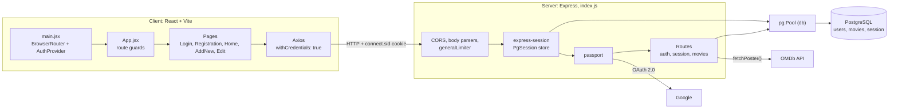
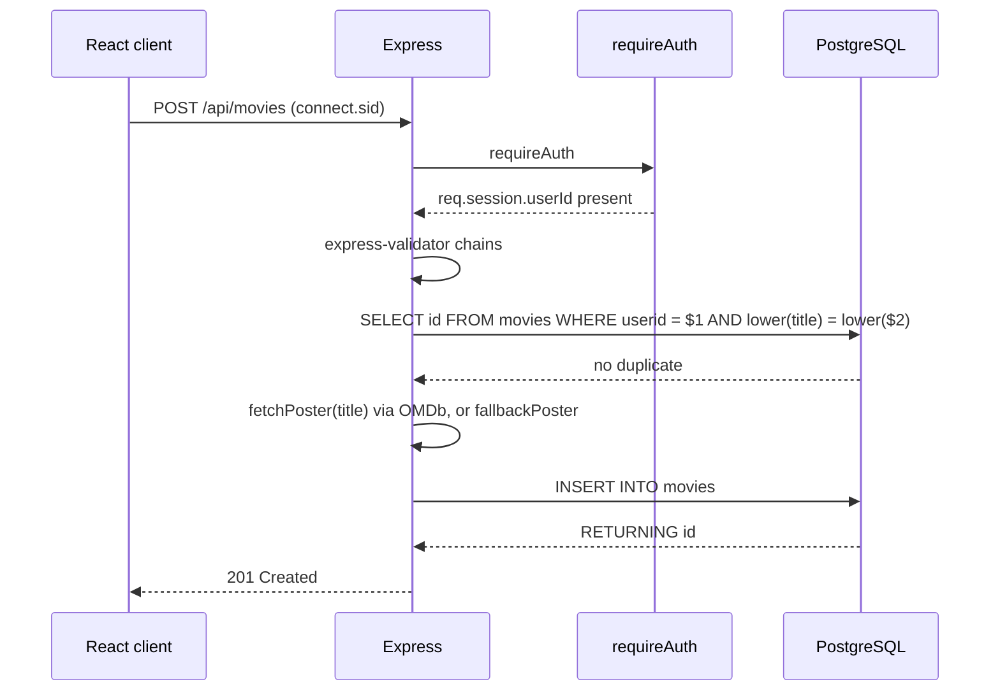
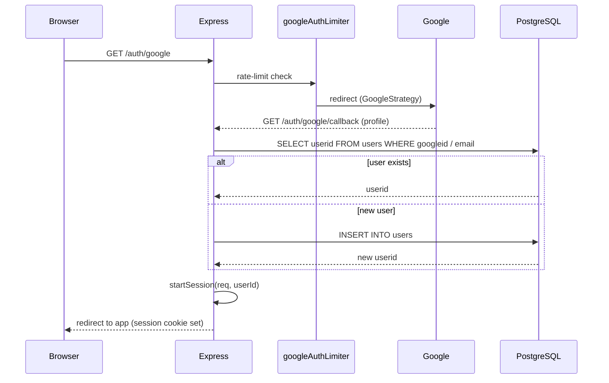
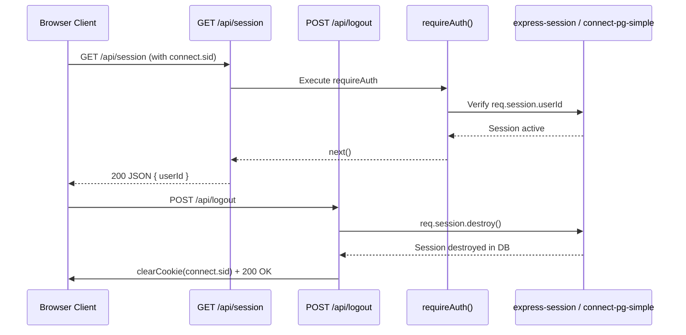
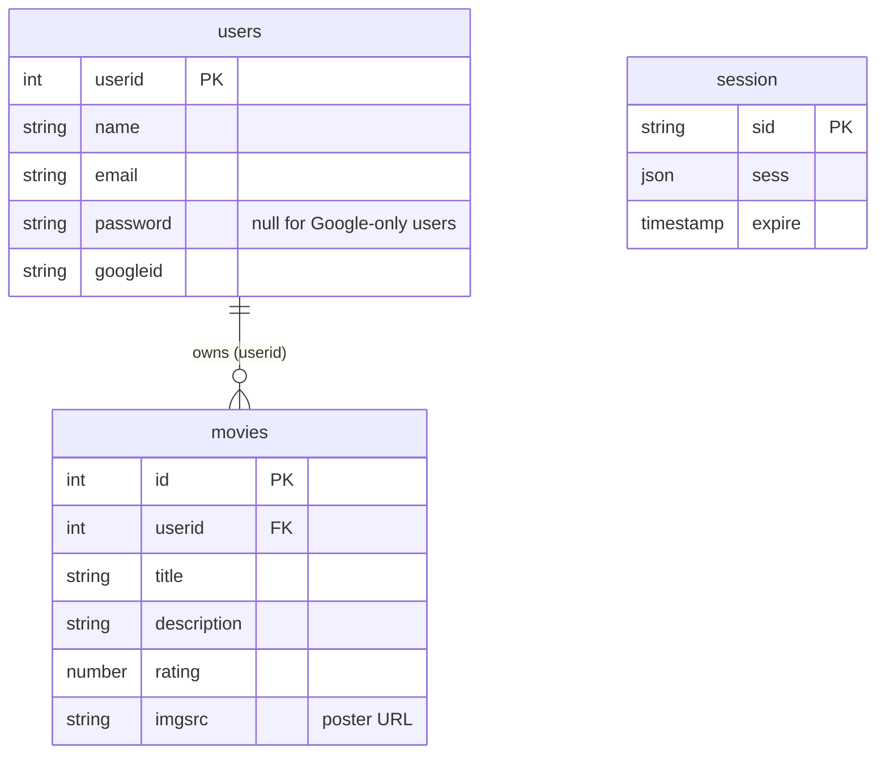
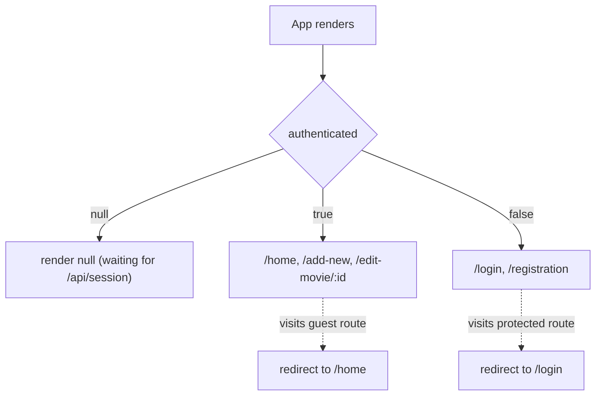
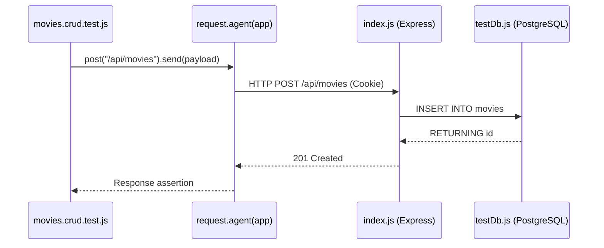

<div align="center">

# 🎬 My Movie Diary

**A full-stack web app for tracking the movies you've watched, with your own ratings and notes.**

[](https://react.dev/)
[](https://expressjs.com/)
[](https://www.postgresql.org/)
[](https://vitest.dev/)
[](https://deepwiki.com/rhythm162k/my_movie_diary)

</div>

---

## Table of Contents

- [Overview](#overview)
- [Features](#features)
- [Tech Stack](#tech-stack)
- [Architecture](#architecture)
- [Project Structure](#project-structure)
- [Getting Started](#getting-started)
- [Available Scripts](#available-scripts)
- [API Reference](#api-reference)
- [Authentication & Sessions](#authentication--sessions)
- [Movies API & OMDb Integration](#movies-api--omdb-integration)
- [Data Model](#data-model)
- [Security](#security)
- [Frontend](#frontend)
- [Styling & Assets](#styling--assets)
- [Testing & Coverage](#testing--coverage)
- [Glossary](#glossary)
- [Documentation](#documentation)
- [Author](#author)

---

## Overview

My Movie Diary is a full-stack application for keeping a personal log of watched movies. The client is a responsive React single-page app bundled with Vite. It talks to a Node.js/Express backend that stores everything in PostgreSQL.

Authentication is session-based and supports two paths: email and password (hashed with `bcrypt`) and Google OAuth 2.0 through Passport. Sessions live in PostgreSQL via `connect-pg-simple`, so they survive server restarts. When you add a movie, the server looks up its poster from the OMDb API and falls back to a default image if none is found.

## Features

- **Personal movie diary.** Add movies with a title, your own description, and a rating from 0 to 10 (0.1 steps).
- **Automatic posters.** Poster artwork is fetched from OMDb, with a fallback image when the lookup fails or returns `N/A`.
- **Search and pagination.** Title search synced to the URL, with client-side pagination (10 movies per page).
- **Edit and delete.** Partial updates send only the fields you changed; deletes are ownership-checked.
- **Duplicate protection.** A case-insensitive check stops you adding the same movie twice (`409 Conflict`).
- **Two sign-in methods.** Email/password and Google OAuth 2.0.
- **Hardened backend.** Rate limiting, input validation, mass-assignment protection, session-fixation protection, and sanitized error responses.
- **Polished UI.** Dark theme driven by CSS custom properties, skeleton loading with a shimmer animation, empty-state artwork, and layouts that adapt from desktop to phone.
- **Tested.** Integration suites with Vitest and Supertest against an isolated PostgreSQL test database.

## Tech Stack

| Layer            | Technologies                                                                                                                                                                       |
| ---------------- | ---------------------------------------------------------------------------------------------------------------------------------------------------------------------------------- |
| **Frontend**     | React, Vite, React Router, Axios, Material UI icons, vanilla CSS with custom properties                                                                                            |
| **Backend**      | Node.js (ES modules), Express, `express-session`, `connect-pg-simple`, Passport (`passport-google-oauth20`), `bcrypt`, `express-validator`, `express-rate-limit`, `cors`, `dotenv` |
| **Database**     | PostgreSQL via `pg` (`pg.Pool`)                                                                                                                                                    |
| **External API** | [OMDb API](https://www.omdbapi.com/) for movie posters                                                                                                                             |
| **Testing**      | Vitest, Supertest, V8 coverage                                                                                                                                                     |
| **Tooling**      | ESLint (flat config), nodemon                                                                                                                                                      |

## Architecture

The diagram below maps the main logical components to the code that implements them.



### Server middleware pipeline

Requests pass through the following layers in order, all configured in `index.js`:

1. **Environment and proxy.** `dotenv` loads configuration, and `trust proxy` is set to `1` so IP resolution and secure cookies work behind reverse proxies and load balancers.
2. **CORS.** Origins are restricted to the configured frontend URL, with `credentials: true` for cookie-based sessions.
3. **Parsing and static files.** JSON and URL-encoded bodies are parsed, and static assets are served from `public/`.
4. **Rate limiting.** `generalLimiter` is applied across `/api`.
5. **Sessions.** `express-session` is backed by PostgreSQL through `connect-pg-simple` (`PgSession`) and shares the same `pg.Pool`.
6. **Authentication.** `passport` is initialized for strategy-based sign-in.
7. **Routes.** Session, Google OAuth, and movie endpoints.

### End-to-end request flow

The React client and the Express server run on different origins, so every request that needs session state sends `withCredentials: true`. Axios defaults are set globally in `frontend/src/main.jsx`, and the browser attaches the `connect.sid` cookie.

On first load, `AuthContext` checks for an existing session by calling `GET /api/session`. A `200` marks the user as authenticated; a `401` marks them as signed out. Children render only after that check finishes, which prevents a flash of the wrong screen or a premature redirect.



## Project Structure

```text
my_movie_diary/
├── index.js                      # Express app: middleware, auth, routes, DB pool
├── package.json                  # Backend manifest and scripts
├── vitest.config.js              # Vitest + coverage configuration
├── middleware/
│   └── rateLimiters.js           # generalLimiter, loginLimiter, googleAuthLimiter
├── public/                       # Static assets served by Express
├── tests/
│   ├── setup.js                  # Global beforeAll / afterAll hooks
│   ├── helpers.js                # createLoggedInUser, insertMovie, ...
│   ├── testDb.js                 # Test DB client with safety guard
│   ├── auth.test.js
│   ├── movies.crud.test.js
│   ├── movies.authz.test.js
│   └── errors.test.js
├── coverage/                     # Generated coverage reports
└── frontend/
    ├── index.html
    ├── vite.config.js
    ├── eslint.config.js
    ├── package.json
    ├── public/                   # app-logo, add-movie, add-new, cancel, search,
    │                             # movie, not-added, not-found, edit-movie (PNGs)
    └── src/
        ├── main.jsx              # Entrypoint: Axios defaults, Router, AuthProvider
        ├── App.jsx               # Routes and auth guards
        ├── api.js                # Exports API_URL from VITE_API_URL
        ├── index.css             # Global theme tokens
        ├── context/
        │   └── AuthContext.jsx   # AuthProvider + useAuth
        ├── components/
        │   ├── Pagination.jsx
        │   └── LoadingSVG.jsx
        └── Pages/
            ├── HomePage/         # HomePage, Header, MovieCard, LogoutButton, SkeletonLoad
            ├── LoginRegistration/# LoginPage, RegistrationPage, GoogleBTN, Divider
            ├── AddNew/           # AddNew.jsx
            └── EditPage/         # EditPage.jsx
```

## Getting Started

### Prerequisites

- [Node.js](https://nodejs.org/) (a version that supports ES modules)
- [PostgreSQL](https://www.postgresql.org/)
- An [OMDb API key](https://www.omdbapi.com/apikey.aspx)
- Google OAuth 2.0 credentials (only needed for Google sign-in)

### 1. Clone the repository

```bash
git clone https://github.com/rhythm162k/my_movie_diary.git
cd my_movie_diary
```

### 2. Configure environment variables

The project has separate package manifests for the backend (repo root) and the frontend (`frontend/`). Environment files live at the root and inside `frontend/`.

**Backend: `.env` (repo root)**

| Variable                                                          | Purpose                                                                           |
| ----------------------------------------------------------------- | --------------------------------------------------------------------------------- |
| `PG_HOST`, `PG_USER`, `PG_PASSWORD`, `PG_DATABASE`, `PG_PORT`     | Connection settings for the `pg` client and the `connect-pg-simple` session store |
| `SESSION_SECRET`                                                  | Secret used to sign the session cookie                                            |
| `OMDB_API_KEY`                                                    | Authenticates movie metadata and poster requests to OMDb                          |
| `GOOGLE_CLIENT_ID`, `GOOGLE_CLIENT_SECRET`, `GOOGLE_CALLBACK_URL` | Credentials for `passport-google-oauth20`                                         |
| `FRONTEND_URL`                                                    | The origin allowed by CORS (read as `frontendUrl` in `index.js`)                  |
| `NODE_ENV`                                                        | Controls cookie flags, bcrypt cost, and rate-limit behavior in tests              |

**Backend tests: `.env.test` (repo root)**

Same keys as above, but `PG_DATABASE` **must contain the word `test`**. The test harness refuses to run otherwise (see [Testing & Coverage](#testing--coverage)).

**Frontend: `frontend/.env`**

| Variable       | Purpose                                                                                        |
| -------------- | ---------------------------------------------------------------------------------------------- |
| `VITE_API_URL` | Base URL of the Express backend. Exposed to the app as `API_URL` through `frontend/src/api.js` |

> Both `.gitignore` files exclude `.env` and `.env.*`, so your secrets are never committed.

### 3. Set up the database

Create a PostgreSQL database for development and a second one for tests (its name must include `test`). The app uses three tables: `users`, `movies`, and the session table used by `connect-pg-simple`. See [Data Model](#data-model) for the structure.

### 4. Run the backend

```bash
npm install
npm start
```

`npm start` runs `nodemon index.js`, so the server reloads on changes.

### 5. Run the frontend

```bash
cd frontend
npm install
npm run dev
```

Vite serves the app with Hot Module Replacement. Make sure `VITE_API_URL` points at the running backend and that the backend's frontend-URL setting matches the Vite dev server origin.

## Available Scripts

**Backend (repo root)**

| Command              | Description                                                              |
| -------------------- | ------------------------------------------------------------------------ |
| `npm start`          | Start the Express server with `nodemon` (ES modules, `"type": "module"`) |
| `npm test`           | Run the test suite once with `vitest run`                                |
| `npm run test:watch` | Run Vitest in watch mode                                                 |
| `npm run coverage`   | Run the tests and generate coverage reports via Vitest and V8            |

**Frontend (`frontend/`)**

| Command           | Description                          |
| ----------------- | ------------------------------------ |
| `npm run dev`     | Start the Vite dev server with HMR   |
| `npm run build`   | Bundle the app into `frontend/dist/` |
| `npm run preview` | Preview the production build locally |
| `npm run lint`    | Run ESLint over all JS/JSX sources   |

## API Reference

All `/api` routes sit behind `generalLimiter`. Routes marked 🔒 require an active session and respond with `401` and `{ "message": "Not authenticated." }` otherwise.

| Method   | Endpoint                | Auth | Description                                                                                        |
| -------- | ----------------------- | :--: | -------------------------------------------------------------------------------------------------- |
| `POST`   | `/api/registration`     |      | Create an account with name, email, and password. Returns `409` if the email is already registered |
| `POST`   | `/api/login`            |      | Sign in with email and password (`loginLimiter`)                                                   |
| `GET`    | `/auth/google`          |      | Start the Google OAuth flow (`googleAuthLimiter`)                                                  |
| `GET`    | `/auth/google/callback` |      | Google OAuth callback (`googleAuthLimiter`)                                                        |
| `GET`    | `/api/session`          |  🔒  | Validate the session and return `{ userId }`                                                       |
| `POST`   | `/api/logout`           |      | Destroy the session and clear the `connect.sid` cookie                                             |
| `GET`    | `/api/movies`           |  🔒  | List the current user's movies, newest first (`ORDER BY id DESC`)                                  |
| `POST`   | `/api/movies`           |  🔒  | Create a movie (`title`, `description`, `rating`)                                                  |
| `GET`    | `/api/movies/search`    |  🔒  | Search the current user's movies (`?title=...`)                                                    |
| `PATCH`  | `/api/movies/edit`      |  🔒  | Partially update a movie (`?id=...`; only `title`, `description`, `rating`)                        |
| `DELETE` | `/api/delete`           |  🔒  | Delete a movie owned by the current user (`?id=...`)                                               |

**Validation rules on movie creation**

- `title` and `description` are trimmed and must be non-empty. Whitespace-only values return `400`.
- `rating` must be a number from `0` to `10` inclusive. Negative numbers, out-of-range values, and non-numeric strings are rejected; `0` and `10` are accepted.
- Resource IDs must be numeric and no larger than `MAX_INT4` (`2147483647`). Values like `abc`, `0`, or `-5` return `400`.
- Malformed JSON bodies return `400` with `{ "message": "Invalid request." }`.

## Authentication & Sessions

### Session store and cookie

Sessions are handled by `express-session` and persisted in PostgreSQL through `connect-pg-simple`. The store (`PgSession`) reuses the application's `pg.Pool`, so sessions survive restarts and share connections efficiently.

```js
const PgSession = connectPgSimple(session);

app.use(
  session({
    store: new PgSession({ pool: db }),
    secret: process.env.SESSION_SECRET,
    resave: false,
    saveUninitialized: false,
    // cookie options...
  }),
);
```

The session cookie (`connect.sid`) is configured per environment:

- `httpOnly` is always on, which mitigates XSS-based cookie theft.
- `secure` is enabled in production.
- `sameSite` is `"lax"` in development and `"none"` in production, to support the cross-origin client.

### Email and password

Passwords are hashed with `bcrypt` and are never stored in plaintext; logins use `bcrypt.compare`. The cost factor (`saltRounds`) is `4` when `NODE_ENV === "test"`, to keep tests fast, and `15` otherwise. Concurrent registrations for the same email are handled safely: if the unique constraint fires between the existence check and the insert (PostgreSQL error `23505`), the server responds with `409 Conflict`.

### Google OAuth 2.0

Google sign-in uses `passport` with `passport-google-oauth20`. When the verify callback runs, it looks for a `users` row matching either `googleid` or `email`. If none exists, a new row is inserted and its `userid` is returned. The session is then created through `startSession`.



### Session helpers and guards

- **`requireAuth(req, res, next)`** checks `req.session.userId`. If it's missing, it responds `401` with `{ message: "Not authenticated." }`. It runs _before_ validation on protected endpoints.
- **`startSession(req, userId)`** calls `req.session.regenerate()` to issue a fresh session ID on login (preventing session fixation), assigns `userId`, and saves the session.
- **`GET /api/session`** returns `200 { userId }` for a valid session.
- **`POST /api/logout`** destroys the session, clears the cookie, and returns a success message.

```js
app.post("/api/logout", (req, res) => {
  req.session.destroy((error) => {
    if (error) {
      console.error(error);
      return res.status(500).json({ message: "Could not log out." });
    }

    res.clearCookie("connect.sid");
    res.status(200).json({ message: "Logged out successfully." });
  });
});
```



## Movies API & OMDb Integration

Every movie route requires a session and is scoped to `req.session.userId`.

### Endpoint behavior

- **`GET /api/movies`** returns the user's movies ordered by `id` descending.

  ```js
  app.get("/api/movies", requireAuth, async (req, res) => {
    try {
      const result = await db.query(
        "SELECT * FROM movies WHERE userid = $1 ORDER BY id DESC",
        [req.session.userId],
      );

      res.json(result.rows);
    } catch (error) {
      console.error(error);
      res.status(500).json({ message: "Something went wrong." });
    }
  });
  ```

- **`POST /api/movies`** validates the payload with `express-validator`, checks for duplicates, resolves a poster, and inserts the row. Returns `201 Created`.
- **`GET /api/movies/search`** filters the user's collection by search term.
- **`PATCH /api/movies/edit`** performs a partial update, restricted to the `EDITABLE_FIELDS` allow-list: `["title", "description", "rating"]`.
- **`DELETE /api/delete`** removes a movie, enforcing ownership. Another user's movie, or one that's already deleted, returns `404`.

### Duplicate detection

Before inserting, `POST /api/movies` runs a case-insensitive lookup scoped to the current user. If a match exists, it short-circuits with `409 Conflict`.

```js
const existingMovie = await db.query(
  "SELECT id FROM movies WHERE userid = $1 AND lower(title) = lower($2)",
  [req.session.userId, title],
);

if (existingMovie.rows.length > 0) {
  return res.status(409).json({
    message: "You already added this movie.",
  });
}
```

### Poster lookup and fallback

For new movies, the server calls `fetchPoster(title)` using `OMDB_API_KEY`. If the request fails, returns a non-OK status, responds with `Response: "False"`, or yields a poster of `"N/A"`, the server uses `fallbackPoster` so the UI always has an image and the insert never fails because of OMDb.

```js
const fallbackPoster =
  "https://cdn.displate.com/artwork/735x1024/2022-04-15/7422bfe15b3ea7b5933dffd896e9c7f9_46003a1b7353dc7b5a02949bd074432a.jpg";

async function fetchPoster(title) {
  const response = await fetch(
    `https://www.omdbapi.com/?apikey=${apiKey}&t=${encodeURIComponent(title)}`,
  );
  if (response.ok) {
    const data = await response.json();
    if (data.Response === "True" && data.Poster && data.Poster !== "N/A") {
      return data.Poster;
    }
  }
  return fallbackPoster;
}
```

## Data Model

The persistence layer is a single `pg.Pool` (`db`) configured from environment variables. It handles reconnection and query queuing, logs unexpected errors, and is shared with the session store.

```js
const db = new pg.Pool({
  user: process.env.PG_USER,
  host: process.env.PG_HOST,
  database: process.env.PG_DATABASE,
  password: process.env.PG_PASSWORD,
  port: process.env.PG_PORT,
});

db.on("error", (error) => {
  console.error("Unexpected database error:", error);
});
```



| Table     | Purpose                                                                                                                 |
| --------- | ----------------------------------------------------------------------------------------------------------------------- |
| `users`   | Local and Google OAuth accounts. `userid` is the primary key. Google-only users have a `googleid` and a `null` password |
| `movies`  | Diary entries, each tied to a user through `userid`: title, description, rating, and poster (`imgsrc`)                  |
| `session` | Managed by `connect-pg-simple`: session ID (`sid`), session data (`sess`), and expiry (`expire`)                        |

### Query patterns

All database access goes through parameterized `db.query()` calls, which prevents SQL injection. Queries are scoped by `req.session.userId` or by OAuth identifiers (`googleid`, `email`).

```js
// Google OAuth user lookup
const existingGoogleUser = await db.query(
  "SELECT userid FROM users WHERE googleid = $1",
  [googleId],
);
```

## Security

| Concern                        | Mitigation                                                                                                    |
| ------------------------------ | ------------------------------------------------------------------------------------------------------------- |
| **Brute force / DDoS**         | `express-rate-limit` via `middleware/rateLimiters.js` (see below)                                             |
| **SQL injection**              | Parameterized queries only                                                                                    |
| **Integer overflow**           | IDs are bounded by `MAX_INT4` (`2147483647`), PostgreSQL's 4-byte integer limit                               |
| **Mass assignment**            | `EDITABLE_FIELDS` allow-list on `PATCH /api/movies/edit`. An injected `userid` in the body is ignored         |
| **Session fixation**           | `req.session.regenerate()` on every successful login (`startSession`)                                         |
| **XSS cookie theft**           | `httpOnly` session cookie, `secure` in production                                                             |
| **CSRF / cross-origin**        | CORS restricted to the frontend origin with credentials; `sameSite` set per environment                       |
| **Data leakage between users** | Every query is scoped by `userid`; cross-user access returns `404`                                            |
| **Information disclosure**     | "Safe 500": details are logged server-side, and the client only sees `{ "message": "Something went wrong." }` |
| **Password storage**           | `bcrypt` hashes (`$2...`), cost 15 in production                                                              |
| **Reverse proxies**            | `trust proxy` set to `1`                                                                                      |

### Rate limiters

| Limiter             | Scope                                      | Limit                                                           |
| ------------------- | ------------------------------------------ | --------------------------------------------------------------- |
| `generalLimiter`    | All `/api` routes                          | 100 requests per 15 minutes                                     |
| `loginLimiter`      | Login routes                               | 10 requests per 15 minutes (skipped when `NODE_ENV === "test"`) |
| `googleAuthLimiter` | `/auth/google` and `/auth/google/callback` | 20 requests per 15 minutes                                      |

## Frontend

The client is a React SPA built with Vite. `frontend/src/main.jsx` sets `axios.defaults.withCredentials = true` and wraps the app in `BrowserRouter` and `AuthProvider`.

### API configuration

```js
// frontend/src/api.js
const API_URL = import.meta.env.VITE_API_URL;

export default API_URL;
```

### Routing and route guards

`App.jsx` reads `authenticated` from `useAuth()`. While it is `null` (session check pending), `App` renders nothing, avoiding premature redirects.

| Route                     | Access     | Behavior                                                                            |
| ------------------------- | ---------- | ----------------------------------------------------------------------------------- |
| `/`                       | Public     | Redirects to `/home` if authenticated, otherwise `/login`                           |
| `/login`, `/registration` | Guest only | Renders `LoginPage` / `RegistrationPage`; redirects to `/home` if already signed in |
| `/home`                   | Protected  | Renders `HomePage`; redirects to `/login` if signed out                             |
| `/add-new`                | Protected  | Renders `AddNew`                                                                    |
| `/edit-movie/:id`         | Protected  | Renders `EditMovie`                                                                 |



### Auth context

`AuthProvider` exposes `authenticated` (a boolean, or `null` while unknown) and `loading` through the `useAuth` hook. On mount it runs a session check, then renders its children only once `loading` is `false`:

```js
const checkSession = async () => {
  try {
    await axios.get(`${API_URL}/api/session`, {
      withCredentials: true,
    });
    setAuthenticated(true);
  } catch {
    setAuthenticated(false);
  } finally {
    setLoading(false);
  }
};
```

### Pages

**Login and Registration**

- `LoginPage` has an email/password form, a visual divider, and a Google button. It posts to `/api/login`; on success it calls `setAuthenticated(true)` and navigates to `/home`. Failures (`401`/`403`/`404`) or network errors show an error message.
- `RegistrationPage` collects name, email, password, and password confirmation. A client-side check blocks mismatched passwords ("Password didn't match") before posting to `/api/registration`. A `409` shows the backend's message, and any other failure shows a generic fallback.
- The Google button redirects the browser to `${API_URL}/auth/google`.

**Home page and movie list** (`HomePage.jsx`)

The central dashboard manages `movies`, `searchResults`, `searchParams`, `loading`, and a `deleted` toggle. A `useEffect` fetches either `/api/movies/search?title=...` or `/api/movies`, depending on whether a search query is in the URL. Toggling `deleted` after a successful delete forces a re-fetch.

```js
const displayedMovies = searchResults !== null ? searchResults : movies;
const totalPages = Math.ceil(displayedMovies.length / moviesPerPage); // 10 per page
const startIndex = (currentPage - 1) * moviesPerPage;
const paginatedMovies = displayedMovies.slice(
  startIndex,
  startIndex + moviesPerPage,
);
```

Depending on state, the body renders skeleton placeholders (`SkeletonLoad`) while loading, empty-state artwork (`not-found.png` or `not-added.png`) when nothing matches, or a grid of `MovieCard` components. Submitting a search resets the page to `1` and updates the URL.

**MovieCard and Header**

`MovieCard` takes `movie` and `handleDelete` props, shows the poster (`movie.imgsrc`), title, rating, and your description under "My Description:", and has edit and delete buttons (Material UI `EditNoteIcon` and `DeleteIcon`). Edit navigates to `/edit-movie/${movie.id}` and passes the movie via router state. `Header` shows the app logo and the `LogoutButton`.

**Logout flow**

`LogoutButton` posts to `/api/logout` with credentials, calls `setAuthenticated(false)` so the UI updates immediately, then navigates to `/login`.

**Skeleton loading and pagination**

- `SkeletonLoad` mirrors the movie card layout to prevent layout shift, using a CSS `::before` pseudo-element with a moving linear gradient (`@keyframes shimmer`).
- `Pagination` takes `currentPage`, `totalPages`, and `onPageChange`, and renders nothing when `totalPages <= 1`. Page numbers collapse with ellipses: all pages up to 7; `1-5 … last` near the start; `1 … last 5` near the end; and `1 … prev, current, next … last` in the middle.

**Add New Movie** (`AddNew.jsx`)

A controlled form with `formData`, `loading`, and `error` state. Title and description are `required` (the description textarea has a 150px minimum height), and rating is a number input from `0` to `10` in `0.1` steps. Submit posts to `/api/movies` with credentials. A `409` shows the duplicate message, success navigates to `/home`, and while the request is in flight the submit button is disabled and swaps its icon for the `LoadingSVG` spinner.

**Edit Movie** (`EditPage.jsx`)

Receives the movie through React Router location state and initializes `formData` from it. On submit it diffs the form against the original and sends only the changed fields with `axios.patch` to `/api/movies/edit` (`params: { id }`, `withCredentials: true`). If nothing changed it returns to `/home` without calling the API. Errors from `error.response.data.message` appear in an error banner.

## Styling & Assets

### Theme

The UI uses vanilla CSS with custom properties declared in `frontend/src/index.css`, plus component-scoped stylesheets.

```css
:root {
  --bg: #111827;
  --surface: #1f2937;
  --primary: #fbdb56;
  --positive: #30d158;
  --negative: #ff453a;
  --text: #f9fafb;
  --muted: #9ca3af;
  --border: #374151;
  --shadow: 0 10px 30px rgba(0, 0, 0, 0.3);
}
```

### Layout and responsive breakpoints

The dashboard grid (`.main-body`) is 3 columns on desktop, up to a `1200px` max width with a `10px` gap. Forms are centered with a `700px` max width.

| Breakpoint        | Stylesheet                              | Behavior                                                                                        |
| ----------------- | --------------------------------------- | ----------------------------------------------------------------------------------------------- |
| `1300px`          | `HomePage.css`                          | Movie grid drops from 3 columns to 2; empty state spans 2                                       |
| `960px`           | `HomePage.css`, `MovieCard.css`         | Search input and buttons go full width; poster and title stack in a centered single column      |
| `768px`           | `AddNew.css`, `EditPage.css`            | Button groups stack vertically at full width                                                    |
| `615px`           | `HomePage.css`, `MovieCard.css`         | Movie grid becomes one column; header elements stack; card padding and poster size shrink       |
| `600px` / `400px` | `LoginPage.css`, `RegistrationPage.css` | Auth card padding steps down (`40px` → `32px 28px` → `28px 20px`, with `12px` radius on mobile) |

### Static assets

PNGs in `frontend/public/` cover branding (`app-logo.png`), action icons (`add-movie.png`, `add-new.png`, `cancel.png`, `search.png`), empty states (`not-added.png`, `not-found.png`), and a generic poster image (`movie.png`). `LoadingSVG` is a reusable animated spinner built from three staggered SVG circles, sized at `24px` inside buttons.

## Testing & Coverage

Tests use **Vitest** as the runner and **Supertest** for HTTP assertions against the Express app, running against an isolated PostgreSQL test database.



### Harness

- **`vitest.config.js`** runs in a Node environment with `fileParallelism: false`, so test files never race on the shared test database. It registers `tests/setup.js` and configures V8 coverage (text and HTML reporters) for `index.js` and `middleware/`.
- **`tests/testDb.js`** loads `.env.test` and refuses to run against a database whose name doesn't contain `"test"`:

  ```js
  if (!process.env.PG_DATABASE?.includes("test")) {
    throw new Error(
      `Refusing to run tests against "${process.env.PG_DATABASE}"`,
    );
  }
  ```

  It exports `testDb`, `connectTestDb()`, and `closeTestDb()`.

- **`tests/setup.js`** connects the test DB in `beforeAll`, and in `afterAll` closes it and ends the main pool (`db.end()`) to avoid open-handle warnings.
- **`tests/helpers.js`** provides the shared utilities:

  | Helper                            | Purpose                                                                         |
  | --------------------------------- | ------------------------------------------------------------------------------- |
  | `createLoggedInUser(email, name)` | Registers a user and returns a logged-in Supertest agent, `userId`, and `email` |
  | `insertMovie(userId, overrides)`  | Inserts a movie directly in the DB, bypassing the API and OMDb                  |
  | `getMovie(id)`                    | Fetches a movie by primary key                                                  |
  | `insertGoogleOnlyUser(email)`     | Seeds a Google-only user (`password` null, `googleid` set)                      |
  | `deleteUsersByEmail(...emails)`   | Cleans up users and their movies (movies first, to satisfy foreign keys)        |
  | `failQueriesContaining(fragment)` | Fault injection: makes matching SQL queries reject                              |

### Test suites

| Suite                  | What it covers                                                                                                                                                                                                                                                                                                                                                                                              |
| ---------------------- | ----------------------------------------------------------------------------------------------------------------------------------------------------------------------------------------------------------------------------------------------------------------------------------------------------------------------------------------------------------------------------------------------------------- |
| `auth.test.js`         | `401` on unauthenticated `/api/session`; login sets an `HttpOnly`, `SameSite=Lax` `connect.sid`; sign-out clears it; login issues a fresh session ID; all protected routes return `401` before validation; registration validation (missing names, bad emails, short passwords); duplicate email returns `409`; passwords are stored as bcrypt hashes; concurrent-registration race (`23505`) returns `409` |
| `movies.crud.test.js`  | Creation with OMDb poster; fallback poster on `Response: "False"`, `"N/A"`, or network error without failing the insert; duplicate returns `409`; whitespace-only fields return `400`; ratings outside `0`-`10` rejected, `0` and `10` accepted                                                                                                                                                             |
| `movies.authz.test.js` | Another user's edit or delete returns `404` and leaves data untouched; list isolation between users; mass-assignment defense (injected `userid` ignored); invalid IDs (`abc`, `0`, `-5`, huge numbers) return `400`; deleting an already-deleted movie returns `404`                                                                                                                                        |
| `errors.test.js`       | Injected DB failures return a safe `500` with `"Something went wrong."` and no internal detail leaked; malformed JSON returns `400` with `"Invalid request."`                                                                                                                                                                                                                                               |

### Coverage

Run `npm run coverage` to regenerate the reports in `coverage/` (text and HTML). Open `coverage/index.html` for the summary, which tracks statements, branches, functions, and lines. `middleware/rateLimiters.js` reaches 100% on all four metrics. In the HTML reports, press `n` or `j` to jump to the next uncovered block and `b`, `p`, or `k` to jump back.

## Glossary

| Term                                                    | Meaning                                                                                                                   |
| ------------------------------------------------------- | ------------------------------------------------------------------------------------------------------------------------- |
| `API_URL`                                               | Frontend base URL for backend requests, read from `import.meta.env.VITE_API_URL` (`frontend/src/api.js`)                  |
| OMDb                                                    | Open Movie Database API used to fetch posters during movie creation                                                       |
| `409 Conflict`                                          | Returned on duplicate movie titles (case-insensitive, per user) and duplicate registrations                               |
| `fallbackPoster`                                        | Constant image URL used when an OMDb lookup fails or returns `N/A`                                                        |
| `PgSession`                                             | Session store built with `connect-pg-simple`, persisting sessions in PostgreSQL                                           |
| `connect.sid`                                           | The `express-session` cookie holding the session ID; cleared on logout                                                    |
| `useAuth`                                               | React hook exposing `authenticated`, loading state, and setters from `AuthContext`                                        |
| `authenticated === null`                                | Transitional state while `/api/session` is pending; the router renders `null` to avoid premature redirects                |
| Protected / guest routes                                | Route guards in `App.jsx`: private views redirect to `/login`; login and registration redirect signed-in users to `/home` |
| `userid`                                                | Primary key of `users`; referenced by `movies` to isolate each user's data                                                |
| `googleid`                                              | Google profile identifier stored on `users` for OAuth accounts                                                            |
| `saltRounds`                                            | bcrypt cost factor: `4` in tests, `15` otherwise                                                                          |
| `withCredentials`                                       | Axios option that sends the HTTP-only session cookie on cross-origin requests                                             |
| `requireAuth`                                           | Middleware returning `401 Not authenticated.` when `req.session.userId` is missing                                        |
| `startSession`                                          | Helper that regenerates the session on login (anti session-fixation) and stores `userId`                                  |
| `EDITABLE_FIELDS`                                       | `["title", "description", "rating"]`, the allow-list that prevents mass assignment on `PATCH`                             |
| `MAX_INT4`                                              | `2147483647`, the upper bound for ID validation (PostgreSQL 4-byte integer max)                                           |
| `generalLimiter` / `loginLimiter` / `googleAuthLimiter` | `express-rate-limit` instances for general API, login, and Google OAuth routes                                            |
| Safe 500                                                | Error pattern: log details server-side, return `{ message: "Something went wrong." }` to the client                       |
| Skeleton load                                           | `SkeletonLoad` placeholder cards shown while movies load                                                                  |
| Shimmer                                                 | Animated CSS gradient on skeleton elements indicating loading                                                             |
| `moviesPerPage`                                         | Layout constant limiting each view to `10` movies                                                                         |
| `searchResults`                                         | State holding filtered results, or `null` when no search is active                                                        |
| `deleted` toggle                                        | Boolean flipped after a successful delete to trigger a re-fetch in `HomePage`                                             |
| `failQueriesContaining`                                 | Test helper that simulates DB failures on matching SQL                                                                    |
| `createLoggedInUser`                                    | Test helper that provisions a user and returns an authenticated Supertest agent                                           |

## Documentation

An auto-generated, source-linked wiki of this codebase is available on DeepWiki:

[](https://deepwiki.com/rhythm162k/my_movie_diary)

## Author

**Md. Sami-El Bashar Rhythm**
GitHub: [@rhythm162k](https://github.com/rhythm162k)
